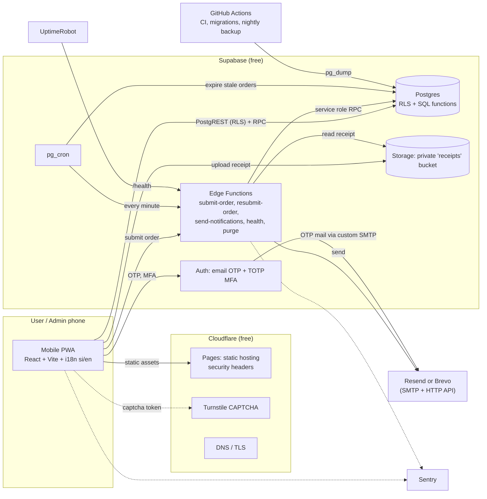
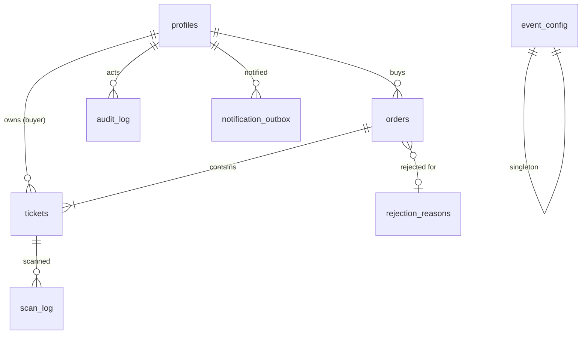
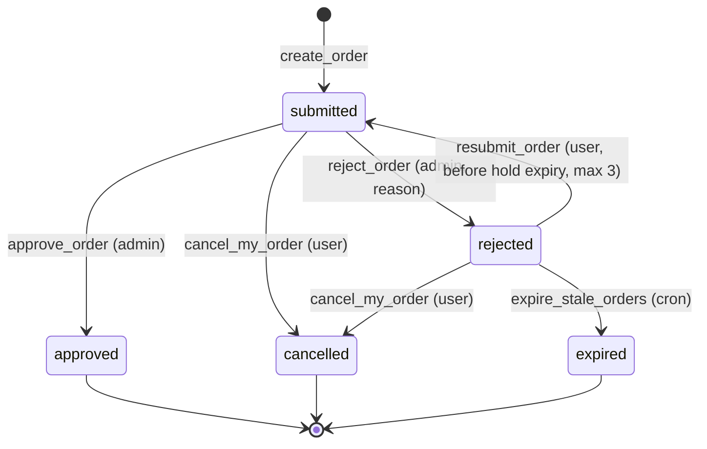
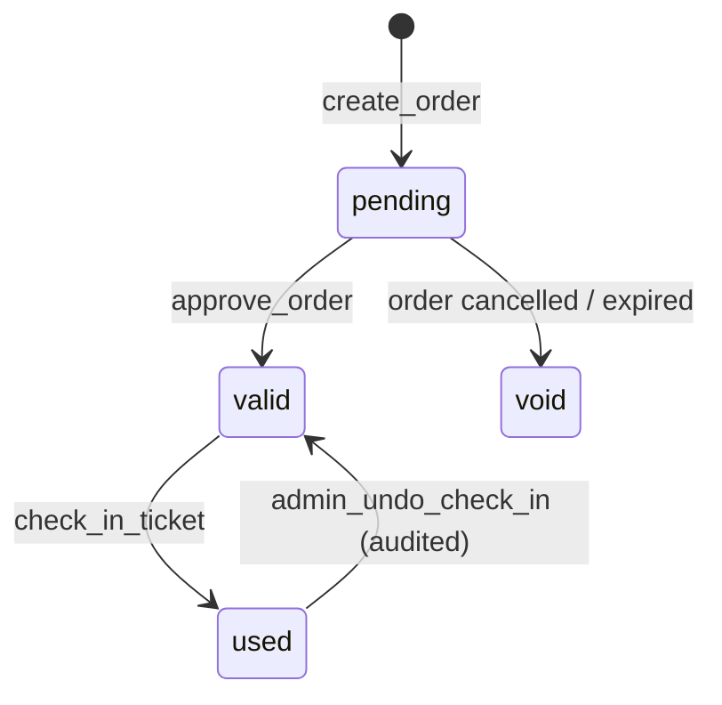

# Batch Party Ticketing Platform: Architecture & Implementation Spec

| | |
|---|---|
| **Status** | Draft v0.1 for dev review |
| **Written** | Thu 29 Oct 2026 |
| **Production release** | **Mon 2 Nov 2026** (4 working days) |
| **Scale** | 500 tickets, ≤ 20 simultaneous users, one-off event |
| **Languages** | Sinhala (`si`) and English (`en`) for all user and admin UI and all emails |
| **Hosting budget** | Free tiers only (plus one optional cheap domain, see §4) |

---

## Contents

0. [How to use this document](#0-how-to-use-this-document)
1. [Requirements and priorities](#1-requirements-and-priorities)
2. [Decisions](#2-decisions)
3. [System architecture](#3-system-architecture)
4. [Free-tier plan and risks](#4-free-tier-plan-and-risks)
5. [Identity, roles, authorization](#5-identity-roles-authorization)
6. [Data model (SQL)](#6-data-model-sql)
7. [State machines](#7-state-machines)
8. [Business logic as SQL functions](#8-business-logic-as-sql-functions)
9. [Edge Functions](#9-edge-functions)
10. [Notifications and WhatsApp](#10-notifications-and-whatsapp)
11. [QR tickets and gate scanning](#11-qr-tickets-and-gate-scanning)
12. [Frontend](#12-frontend)
13. [Localisation (Sinhala)](#13-localisation-sinhala)
14. [Admin dashboard spec](#14-admin-dashboard-spec)
15. [Security and privacy](#15-security-and-privacy)
16. [Observability](#16-observability)
17. [Testing and acceptance](#17-testing-and-acceptance)
18. [Delivery plan to 2 Nov](#18-delivery-plan-to-2-nov)
19. [Event-day runbook](#19-event-day-runbook)
20. [Open questions](#20-open-questions)
- [Appendix A: Error codes](#appendix-a-error-codes)
- [Appendix B: Environment variables](#appendix-b-environment-variables)
- [Appendix C: Draft Sinhala strings](#appendix-c-draft-sinhala-strings)

---

## 0. How to use this document

- Every requirement has an ID (`U-2`, `A-3`, `N-3`…). The atomic work plan should reference these IDs.
- **MUST / SHOULD / MAY** are used in the RFC sense.
- SQL in §6 and §8 is a **reference implementation**. It is meant to be copied into `supabase/migrations/` and then covered by the pgTAP tests in §17. Treat it as reviewed-but-untested until those tests pass.
- Section 12's route table and §9's Edge Function contracts are the **interfaces between workstreams**. Agree on them first; then DB, web user flow, admin UI and infra/i18n can proceed in parallel.
- Anything marked `P0` blocks release. `P1` ships if the schedule allows. `P2` is post-release.

---

## 1. Requirements and priorities

### 1.1 Functional

| ID | Role | Requirement | Priority |
|---|---|---|---|
| D-1 | Dev | Approve and revoke admins. Admin access requires dev approval and MFA | P0 |
| D-2 | Dev | Full observability: audit log viewer, health page, error tracking, uptime, notification queue state | P0 |
| A-1 | Admin | Uniquely identifiable: own login, MFA, a stable `staff_code`, and every action stamped with it | P0 |
| A-2 | Admin | See all user details with comprehensive filtering, multi-column sorting, search, pagination | P0 |
| A-3 | Admin | Approve a payment, or reject it with a reason (template + free text) that is sent to the user | P0 |
| A-4 | Admin | Payment analytics (revenue, status mix, turnaround, sales over time, per-admin throughput) | P1 (basic P0) |
| A-5 | Admin | Scan a QR at the gate to verify entry; manual lookup fallback | P0 |
| A-6 | Admin | Match a submission to a WhatsApp group join request and mark the user as added | P1 |
| U-1 | User | Uniquely identified (verified email + unique phone + optional ID/batch number) | P0 |
| U-2 | User | Fill a form (details, ticket holders, payment info) and upload a receipt to buy tickets | P0 |
| U-3 | User | Confirmation of receipt by email with QR codes; WhatsApp group link shown at the end of the form | P0 |
| U-4 | User | Come back later and see progress per order and per ticket | P0 |
| U-5 | User | Buy more tickets for others from the same account (multiple orders, many holders) | P0 |
| L-1 | All | Full Sinhala + English localisation, switchable at any time, including emails and error messages | P0 |

### 1.2 Non-functional

| ID | Requirement | How it is met (section) |
|---|---|---|
| N-1 | Mobile-first | Single-column responsive UI, 44px+ touch targets, camera scanning, PWA (§12) |
| N-2 | Safety | RLS everywhere, private receipts, MFA, audit log, CSP, Turnstile (§5, §15) |
| N-3 | Deterministic + atomic | All state changes in SQL functions with explicit locks and idempotency (§8) |
| N-4 | Fast | Static CDN frontend, indexed queries, tiny payloads, one region close to Sri Lanka (§12.6) |
| N-5 | Uptime | Keep-alive, uptime monitors, nightly backups, gate fallback procedure (§16, §19) |
| N-6 | Free hosting | §4 |

### 1.3 Capacity assumptions

- 500 tickets total, at most about 300 orders, at most 20 simultaneous users. Load is trivial; **correctness and event-day reliability are the real risks**, not throughput.
- Receipts ≈ 0.3–0.5 MB each after client compression, so ≈ 150–250 MB total.
- Emails: ≈ 3 per order, so ≈ 1,000 in total.

---

## 2. Decisions

| # | Decision | Alternatives rejected | Reason |
|---|---|---|---|
| ADR-1 | **Vite + React + TypeScript SPA (PWA)**, static-hosted on Cloudflare Pages | Next.js, SvelteKit | No SSR needed. All trusted logic lives in Postgres and Edge Functions, so the frontend is static. Fewest moving parts for a 4-day build |
| ADR-2 | **Supabase** (Postgres, Auth, Storage, Edge Functions, pg_cron) as the entire backend | Custom Node server, all-Cloudflare (Workers + D1) | Real ACID transactions, RLS, built-in MFA and private storage. No server to host |
| ADR-3 | **Business rules as Postgres functions** (`SECURITY DEFINER`), RLS as the second line of defense | Logic in the frontend or in many Edge Functions | One transaction per operation gives atomicity; clients cannot bypass rules |
| ADR-4 | **Email OTP (6-digit code)**, not magic links | Magic link, Google login | In-app browsers (WhatsApp, Facebook) open links in a different browser context and lose the session. A typed code avoids that. Google login is cut (P2) |
| ADR-5 | **WhatsApp = group invite link** shown after submit; admin approves join requests manually | WhatsApp Cloud API | Free, no business verification, no templates. Admin cross-checks the joiner's number against submissions |
| ADR-6 | **QR stays identical from submission to approval**; a pending ticket shows **"Waiting for approval"** | Issue the QR only after approval | The user gets the QR at once (U-3). The gate scanner refuses entry until approval |
| ADR-7 | **Receipts verified server-side** in an Edge Function (magic bytes, size, SHA-256) before the order is created | Trust client-supplied hash | Duplicate-receipt detection must not be bypassable |
| ADR-8 | **Notifications via a DB outbox** drained by an Edge Function + cron retries | Send mail inline in the request | The approval transaction stays atomic and email failures never roll back an approval |
| ADR-9 | **Polling (TanStack Query) instead of Realtime** | Supabase Realtime | Fewer failure modes; at 20 users, 10–15 s polling is fine |
| ADR-10 | Server returns **stable error codes**, never localized text | Localized server messages | The client owns translation (§13) |
| ADR-11 | **Online scanner is P0; offline scanner is P1**. Fallback is a printed or CSV door list | Offline as P0 | Deadline. Offline adds a sync-conflict surface. Spec in §11.4 |
| ADR-12 | **Flat price** (assumption). Tiered pricing would need a `ticket_types` table | | Confirm in §20 |

---

## 3. System architecture



### 3.1 Responsibilities

| Component | Owns | MUST NOT |
|---|---|---|
| PWA | UI, validation (UX only), image compression, QR display/scan, i18n | Hold any secret except the public Supabase key; make trust decisions |
| Postgres | All state, all transitions, authorization (RLS), idempotency, audit | Trust the caller's claimed role or user id (always `auth.uid()` or an explicit service-role actor) |
| Edge Functions | Receipt verification, captcha check, mail sending, health | Hold business rules (they call SQL functions) |
| Storage | Receipt files (private) | Be public; allow overwrite or delete by users |
| Cloudflare Pages | Static files, headers | Run logic |

### 3.2 Environments

| Env | Supabase project | Purpose |
|---|---|---|
| local | `supabase start` (Docker) | Day-to-day development, pgTAP |
| staging | free project #1 | Integration, load test, dry run |
| prod | free project #2 | Release |

Both free projects can be active at once. Migrations live in git and are applied by CI. **Never edit the prod schema in the dashboard.**

### 3.3 Repository layout

```
/
├─ web/                         # Vite React app
│  ├─ src/
│  │  ├─ routes/                # user/, admin/, dev/, scan/
│  │  ├─ components/
│  │  ├─ lib/                   # supabase client, api wrappers, errors, format
│  │  ├─ i18n/                  # en.json, si.json, index.ts
│  │  └─ pwa/                   # service worker config, scanner cache
│  ├─ public/fonts/             # subsetted Noto Sans Sinhala
│  ├─ public/_headers           # Cloudflare security headers
│  └─ vite.config.ts
├─ supabase/
│  ├─ migrations/               # 001_*.sql … (see §6)
│  ├─ functions/
│  │  ├─ _shared/               # auth, errors, zod schemas, mail templates, i18n
│  │  ├─ submit-order/
│  │  ├─ resubmit-order/
│  │  ├─ send-notifications/
│  │  ├─ health/
│  │  └─ purge-event-data/
│  ├─ tests/                    # pgTAP + concurrency scripts
│  ├─ seed.sql                  # local/staging only
│  └─ config.toml
├─ load-tests/                  # k6 scripts
├─ docs/                        # this file, runbook
└─ .github/workflows/           # ci.yml, deploy.yml, backup.yml
```

---

## 4. Free-tier plan and risks

| Need | Service | Notes |
|---|---|---|
| Static hosting, CDN, TLS, headers | Cloudflare Pages | Also hosts Turnstile and DNS. Vercel's free tier restricts commercial use, so it is avoided |
| DB, auth, storage, functions, cron | Supabase free | Two projects (staging + prod) |
| Transactional mail | Resend or Brevo free | **Needs a sending domain for good deliverability** (see risk R-1) |
| Errors | Sentry free | PII scrubbing on |
| Uptime | UptimeRobot free | 5-minute checks |
| CI, backups | GitHub Actions | Nightly encrypted `pg_dump` |
| CAPTCHA | Cloudflare Turnstile | Supabase Auth supports Turnstile natively |

### 4.1 Risk register

| ID | Risk | Mitigation |
|---|---|---|
| R-1 | **Email deliverability.** Supabase's built-in SMTP is heavily restricted and is for development only. Mail from a `*.pages.dev` domain cannot be verified; mail "from" a free `@gmail.com` address is likely to fail DMARC | Buy a cheap domain (the one non-free item), verify it with Resend/Brevo (SPF, DKIM, DMARC), configure custom SMTP in Supabase Auth. **Decide by Fri 30 Oct** |
| R-2 | Free Supabase projects pause after inactivity, and there is no point-in-time recovery | UptimeRobot hits `/health` (which runs a DB query) every 5 min; nightly encrypted `pg_dump` to GitHub artifacts (7-day retention); verify one restore on staging |
| R-3 | Free-tier quotas (DB size, storage, egress, function invocations, auth emails, mail sends) | Our footprint is in §1.3. **A dev MUST compare against each provider's current published limits by Fri and record the result in `docs/quotas.md`.** Limits change; do not rely on memory |
| R-4 | Gate Wi-Fi / mobile data fails on the day | Door CSV printed; manual lookup by short code; offline scanner (P1, §11.4) |
| R-5 | Single points of failure (Supabase, Cloudflare, mail) | Runbook (§19). No automatic failover is feasible at this budget |
| R-6 | 4-day schedule | Priorities in §1 and cut list in §18 |

**Region:** pick the Supabase region with the lowest latency from Colombo (compare Mumbai `ap-south-1` and Singapore `ap-southeast-1` with a quick ping test). The region cannot be changed later.

---

## 5. Identity, roles, authorization

### 5.1 Roles

| Role | How obtained | Capabilities |
|---|---|---|
| `user` | Any verified email | Own profile, own orders and tickets |
| `admin` | User requests admin access; a `dev` approves | All users/orders/tickets (read), approve/reject, scan, analytics. **Requires MFA (aal2)** |
| `dev` | Seeded manually (SQL) for 1–2 people | Everything admin can, plus approve/revoke admins, audit log, health, config. **Requires MFA (aal2)** |

### 5.2 Unique identification (U-1, A-1)

- **Users:** `auth.users.id` (UUID, primary) + verified **unique email** + **unique phone** (E.164, e.g. `+94771234567`) + optional unique `id_number` (national ID or batch/student ID, decide in §20). A short `public_code` (e.g. `U-7K3Q9X`) is shown in UIs and quoted in support chats. Phone is **not** SMS-verified (no free SMS); uniqueness is the control.
  - Trade-off: a "phone already used" error reveals that the number is registered. Accepted.
- **Admins:** a unique `staff_code` (`A001`, `A002`…) assigned at approval, shown in the admin header and stamped on every review (`orders.reviewed_by` → profile → `staff_code`) and audit row.

### 5.3 Authentication flow

1. User enters email, passes Turnstile (Supabase Auth CAPTCHA), receives a **6-digit OTP** by email (bilingual template, §13.7).
2. Session persists (long-lived refresh token) so users can come back (U-4).
3. First purchase asks for profile details (`update_my_profile`).
4. **Admin access:** an authenticated user taps "Request admin access" → `admin_requested_at` is set → a dev sees it in `/dev/admins` → approves (`dev_set_admin`) → on next login the admin must enroll **TOTP** (Supabase MFA) and verify to reach `/admin`. Until `aal2`, every admin RLS check fails, so a stolen password alone does nothing.
5. **First dev:** sign up normally, then run once in the SQL editor:
   `update public.profiles set role = 'dev', staff_code = 'D001' where email = 'you@example.com';`

### 5.4 Authorization principles

- Clients get **SELECT-only** access to tables through RLS. **All writes go through functions.** There are no direct INSERT/UPDATE/DELETE grants for `anon` or `authenticated`.
- Functions that modify state check `private.is_admin()` / `private.is_dev()` or `auth.uid()` ownership inside the function.
- Functions that need an explicit actor (called from Edge Functions) are executable by `service_role` **only**.
- Supabase grants `EXECUTE` on new functions to `anon`/`authenticated` by default. The migration in §6.7 revokes this and grants per function. **Reviewers: any new function without an explicit grant block is a bug.**

---

## 6. Data model (SQL)



Migration files, applied in this order:

| File | Content |
|---|---|
| `001_extensions_types.sql` | Extensions, schemas, enums |
| `002_core_tables.sql` | Tables, indexes, seed reasons |
| `003_private_helpers.sql` | `private.*` helpers (codes, MAC, audit, role checks) |
| `004_functions_user.sql` | Profile, order, cancel, public info |
| `005_functions_admin_dev.sql` | Review, check-in, admin/dev functions, analytics, views |
| `006_rls_grants.sql` | RLS policies, revokes/grants |
| `007_storage.sql` | Bucket + storage policies |
| `008_cron.sql` | Scheduled jobs |

### 6.1 `001_extensions_types.sql`

```sql
create extension if not exists pgcrypto  with schema extensions;
create extension if not exists pg_trgm   with schema extensions;
create extension if not exists pg_cron;   -- enable in dashboard first
create extension if not exists pg_net;

create schema if not exists private;      -- NOT exposed through the API

create type public.user_role      as enum ('user', 'admin', 'dev');
create type public.account_status as enum ('active', 'suspended');
create type public.order_status   as enum ('submitted', 'approved', 'rejected', 'cancelled', 'expired');
create type public.ticket_status  as enum ('pending', 'valid', 'used', 'void');
create type public.scan_result    as enum ('ok', 'waiting_approval', 'already_used', 'void', 'invalid');
create type public.notif_status   as enum ('queued', 'sending', 'sent', 'failed', 'dead');
```

### 6.2 `002_core_tables.sql`

```sql
-- Code generator for human-friendly ids (no I, L, O, 0, 1). NOT a secret.
create or replace function private.gen_code(prefix text, n int) returns text
language sql volatile as $$
  select prefix || '-' || string_agg(
    substr('ABCDEFGHJKMNPQRSTUVWXYZ23456789', 1 + floor(random() * 31)::int, 1), '')
  from generate_series(1, n)
$$;

create sequence private.staff_seq;

------------------------------------------------------------------ profiles
create table public.profiles (
  id                uuid primary key references auth.users(id) on delete restrict,
  public_code       text not null unique default private.gen_code('U', 6),
  staff_code        text unique,                       -- 'A001' for admins, 'D001' for devs
  role              public.user_role not null default 'user',
  status            public.account_status not null default 'active',
  email             text not null unique check (email = lower(email)),
  full_name         text check (char_length(full_name) between 2 and 80),
  phone_e164        text unique check (phone_e164 ~ '^\+[1-9][0-9]{7,14}$'),
  whatsapp_e164     text check (whatsapp_e164 ~ '^\+[1-9][0-9]{7,14}$'),
  id_number         text unique check (char_length(id_number) between 3 and 30),
  locale            text not null default 'en' check (locale in ('si', 'en')),
  admin_requested_at timestamptz,
  admin_approved_by uuid references public.profiles(id),
  admin_approved_at timestamptz,
  whatsapp_added_at timestamptz,                        -- set by admin (A-6)
  whatsapp_added_by uuid references public.profiles(id),
  created_at        timestamptz not null default now(),
  updated_at        timestamptz not null default now()
);
create index profiles_name_trgm  on public.profiles using gin (full_name extensions.gin_trgm_ops);
create index profiles_email_trgm on public.profiles using gin (email extensions.gin_trgm_ops);
create index profiles_phone_idx  on public.profiles (phone_e164);
create index profiles_role_idx   on public.profiles (role) where role <> 'user';

---------------------------------------------------------------- event_config
create table public.event_config (
  id                     boolean primary key default true check (id),   -- singleton row
  name                   text not null,
  venue                  text,
  starts_at              timestamptz not null,
  capacity               int  not null check (capacity > 0),
  unit_price_minor       int  not null check (unit_price_minor >= 0),    -- LKR cents
  currency               char(3) not null default 'LKR',
  sales_open_at          timestamptz not null,
  sales_close_at         timestamptz not null,
  sales_paused           boolean not null default false,
  max_tickets_per_order  int not null default 10 check (max_tickets_per_order between 1 and 50),
  max_tickets_per_account int not null default 20,
  rejected_hold_minutes  int not null default 1440,   -- seats held 24h after a rejection
  max_resubmits          int not null default 3,
  whatsapp_group_url     text check (whatsapp_group_url is null
                                     or whatsapp_group_url ~ '^https://chat\.whatsapp\.com/[A-Za-z0-9]+$'),
  bank_details           jsonb not null default '{}',  -- {"bank","account_name","account_no","branch","note_en","note_si"}
  updated_at             timestamptz not null default now(),
  updated_by             uuid references public.profiles(id)
);

------------------------------------------------------------ rejection_reasons
create table public.rejection_reasons (
  code      text primary key,
  label_en  text not null,
  label_si  text not null,
  sort      int  not null default 0,
  active    boolean not null default true
);
insert into public.rejection_reasons (code, label_en, label_si, sort) values
 ('amount_mismatch',   'Amount does not match the order total',  'මුදල ඇණවුමේ මුළු මුදලට නොගැලපේ', 1),
 ('receipt_unreadable','Receipt is unclear or unreadable',       'රිසිට්පත පැහැදිලි නැත',            2),
 ('payment_not_found', 'Payment not found in our account',       'අපගේ ගිණුමේ ගෙවීම සොයාගත නොහැක',  3),
 ('wrong_account',     'Paid to a different account',            'වෙනත් ගිණුමකට ගෙවා ඇත',            4),
 ('other',             'Other (see note)',                       'වෙනත් (සටහන බලන්න)',               9);

-------------------------------------------------------------------- orders
create table public.orders (
  id                uuid primary key default gen_random_uuid(),
  order_no          text not null unique default private.gen_code('ORD', 6),
  buyer_id          uuid not null references public.profiles(id),
  status            public.order_status not null default 'submitted',
  ticket_count      int  not null check (ticket_count between 1 and 50),
  unit_price_minor  int  not null,
  total_minor       int  not null check (total_minor >= 0),
  currency          char(3) not null default 'LKR',
  -- payment claim by the buyer
  payer_name        text not null,
  bank_name         text,
  payment_ref       text not null,        -- normalised: upper-case, A-Z0-9 only
  paid_on           date,
  -- receipt (verified server-side)
  receipt_path      text not null,
  receipt_sha256    char(64) not null,
  receipt_mime      text not null,
  receipt_bytes     int  not null,
  -- review
  reviewed_by       uuid references public.profiles(id),
  reviewed_at       timestamptz,
  review_note       text,
  reject_reason_code text references public.rejection_reasons(code),
  reject_reason_text text,
  hold_expires_at   timestamptz,          -- only while rejected
  resubmit_count    int not null default 0,
  idempotency_key   uuid not null,
  submitted_at      timestamptz not null default now(),
  last_submitted_at timestamptz not null default now(),
  created_at        timestamptz not null default now(),
  updated_at        timestamptz not null default now(),
  constraint orders_idem_uk unique (buyer_id, idempotency_key),
  constraint orders_reject_has_reason check (status <> 'rejected' or reject_reason_code is not null),
  constraint orders_reject_other_has_text check (reject_reason_code <> 'other' or char_length(coalesce(reject_reason_text, '')) >= 3)
);
-- The same slip / reference cannot back two live orders (A-3 anti-fraud)
create unique index orders_active_receipt_uk on public.orders (receipt_sha256)
  where status in ('submitted', 'approved');
create unique index orders_active_payref_uk  on public.orders (payment_ref)
  where status in ('submitted', 'approved');
create index orders_status_submitted_idx on public.orders (status, last_submitted_at);
create index orders_buyer_idx            on public.orders (buyer_id, created_at desc);
create index orders_payref_trgm          on public.orders using gin (payment_ref extensions.gin_trgm_ops);

------------------------------------------------------------------- tickets
create table public.tickets (
  id              uuid primary key default gen_random_uuid(),
  order_id        uuid not null references public.orders(id) on delete cascade,
  buyer_id        uuid not null references public.profiles(id),   -- denormalised for RLS
  seq             smallint not null,
  short_code      text not null unique default private.gen_code('T', 6),   -- manual lookup at the gate
  holder_name     text not null check (char_length(holder_name) between 2 and 80),
  holder_phone    text,
  status          public.ticket_status not null default 'pending',
  qr_version      smallint not null default 1,          -- bump to invalidate and reissue a QR
  checked_in_at   timestamptz,
  checked_in_by   uuid references public.profiles(id),
  checked_in_gate text,
  void_reason     text,
  created_at      timestamptz not null default now(),
  updated_at      timestamptz not null default now(),
  constraint tickets_order_seq_uk unique (order_id, seq),
  constraint tickets_used_has_time check ((status = 'used') = (checked_in_at is not null))
);
create index tickets_buyer_idx  on public.tickets (buyer_id);
create index tickets_active_idx on public.tickets (status) where status <> 'void';   -- capacity count
create index tickets_name_trgm  on public.tickets using gin (holder_name extensions.gin_trgm_ops);

---------------------------------------------------------------- audit_log
create table public.audit_log (
  id          bigint generated always as identity primary key,
  at          timestamptz not null default now(),
  actor_id    uuid,
  actor_role  text,
  action      text not null,                  -- 'order.approve', 'ticket.check_in', 'admin.grant' …
  entity_type text not null,
  entity_id   text,
  old_data    jsonb,
  new_data    jsonb,
  meta        jsonb not null default '{}',
  ip          text,                           -- text on purpose: a malformed header must never break a write
  request_id  text
);
create index audit_at_idx     on public.audit_log (at desc);
create index audit_entity_idx on public.audit_log (entity_type, entity_id);
create index audit_actor_idx  on public.audit_log (actor_id, at desc);

------------------------------------------------------------------ scan_log
create table public.scan_log (
  id           bigint generated always as identity primary key,
  ticket_id    uuid references public.tickets(id),
  result       public.scan_result not null,
  scanned_by   uuid references public.profiles(id),
  gate         text,
  device_id    text,
  offline      boolean not null default false,
  scanned_at   timestamptz not null,
  received_at  timestamptz not null default now()
);
create index scan_log_ticket_idx on public.scan_log (ticket_id, scanned_at);
create index scan_log_time_idx   on public.scan_log (scanned_at);

------------------------------------------------------- notification_outbox
create table public.notification_outbox (
  id              bigint generated always as identity primary key,
  dedupe_key      text not null unique,        -- '<kind>:<order_id>:<resubmit_count>'
  kind            text not null check (kind in
                    ('order_received', 'order_approved', 'order_rejected', 'order_resubmitted', 'order_expired')),
  user_id         uuid references public.profiles(id),
  to_email        text not null,
  locale          text not null default 'en',
  payload         jsonb not null,
  status          public.notif_status not null default 'queued',
  attempts        int  not null default 0,
  next_attempt_at timestamptz not null default now(),
  claimed_at      timestamptz,
  last_error      text,
  created_at      timestamptz not null default now(),
  sent_at         timestamptz
);
create index outbox_due_idx on public.notification_outbox (next_attempt_at)
  where status in ('queued', 'failed');

-- touch updated_at
create or replace function private.touch_updated_at() returns trigger language plpgsql as $$
begin new.updated_at := now(); return new; end $$;
create trigger t_profiles_touch before update on public.profiles for each row execute function private.touch_updated_at();
create trigger t_orders_touch   before update on public.orders   for each row execute function private.touch_updated_at();
create trigger t_tickets_touch  before update on public.tickets  for each row execute function private.touch_updated_at();
```

### 6.3 `003_private_helpers.sql`

```sql
-- Server-side secret for QR MACs. Insert ONCE per environment, never commit:
--   insert into private.secrets values ('qr_hmac', encode(extensions.gen_random_bytes(32), 'hex'));
create table private.secrets (name text primary key, value text not null);
revoke all on private.secrets from public, anon, authenticated;

-- Role checks. Admin and dev both REQUIRE aal2 (MFA).
create or replace function private.is_admin() returns boolean
language sql stable security definer set search_path = '' as $$
  select coalesce(auth.jwt() ->> 'aal', '') = 'aal2'
     and exists (select 1 from public.profiles p
                 where p.id = auth.uid() and p.role in ('admin', 'dev') and p.status = 'active')
$$;
create or replace function private.is_dev() returns boolean
language sql stable security definer set search_path = '' as $$
  select coalesce(auth.jwt() ->> 'aal', '') = 'aal2'
     and exists (select 1 from public.profiles p
                 where p.id = auth.uid() and p.role = 'dev' and p.status = 'active')
$$;

-- QR MAC: 22 base64url chars (132 bits) of HMAC-SHA256(ticket id + version)
create or replace function private.qr_mac(p_ticket uuid, p_ver smallint) returns text
language sql stable security definer set search_path = '' as $$
  select translate(substr(encode(
           extensions.hmac('ticket:' || p_ticket::text || ':' || p_ver::text,
                           (select value from private.secrets where name = 'qr_hmac'),
                           'sha256'), 'base64'), 1, 22), '+/', '-_')
$$;

create or replace function private.qr_payload(p_ticket uuid, p_ver smallint) returns text
language sql stable security definer set search_path = '' as $$
  select 'ST1.' || p_ticket::text || '.' || private.qr_mac(p_ticket, p_ver)
$$;

-- Append-only audit writer. request_id / ip come from PostgREST request headers.
create or replace function private.audit(
  p_action text, p_entity text, p_entity_id text,
  p_old jsonb, p_new jsonb, p_meta jsonb default '{}'::jsonb,
  p_actor uuid default auth.uid()) returns void
language plpgsql security definer set search_path = '' as $$
declare h jsonb := coalesce(nullif(current_setting('request.headers', true), '')::jsonb, '{}'::jsonb);
begin
  insert into public.audit_log (actor_id, actor_role, action, entity_type, entity_id, old_data, new_data, meta, ip, request_id)
  values (p_actor, (select role::text from public.profiles where id = p_actor), p_action, p_entity, p_entity_id,
          p_old, p_new, p_meta, nullif(split_part(coalesce(h ->> 'x-forwarded-for', ''), ',', 1), ''), h ->> 'x-request-id');
end $$;

create or replace function private.audit_immutable() returns trigger language plpgsql as $$
begin raise exception 'audit_log is append-only'; end $$;
create trigger audit_no_update before update or delete on public.audit_log
  for each row execute function private.audit_immutable();

-- New auth user -> bare profile (details are collected at first purchase)
create or replace function private.handle_new_user() returns trigger
language plpgsql security definer set search_path = '' as $$
begin
  insert into public.profiles (id, email, locale)
  values (new.id, lower(new.email),
          case when new.raw_user_meta_data ->> 'locale' = 'si' then 'si' else 'en' end);
  return new;
end $$;
create trigger on_auth_user_created after insert on auth.users
  for each row execute function private.handle_new_user();

-- Builds the email payload INCLUDING qr payloads, and enqueues it (idempotent).
create or replace function private.enqueue_order_mail(p_order uuid, p_kind text) returns void
language plpgsql security definer set search_path = '' as $$
declare o public.orders; p public.profiles; cfg public.event_config; r public.rejection_reasons; v jsonb;
begin
  select * into o   from public.orders where id = p_order;
  select * into p   from public.profiles where id = o.buyer_id;
  select * into cfg from public.event_config where id = true;
  select * into r   from public.rejection_reasons where code = o.reject_reason_code;
  v := jsonb_build_object(
    'order_no', o.order_no, 'status', o.status, 'total_minor', o.total_minor, 'currency', o.currency,
    'buyer_name', p.full_name,
    'event', jsonb_build_object('name', cfg.name, 'venue', cfg.venue, 'starts_at', cfg.starts_at),
    'whatsapp_group_url', cfg.whatsapp_group_url,
    'reject', case when o.status = 'rejected' then jsonb_build_object(
                'code', o.reject_reason_code, 'label_en', r.label_en, 'label_si', r.label_si,
                'note', o.reject_reason_text, 'hold_expires_at', o.hold_expires_at) end,
    'tickets', (select coalesce(jsonb_agg(jsonb_build_object(
                  'seq', t.seq, 'holder_name', t.holder_name, 'short_code', t.short_code,
                  'status', t.status, 'qr', private.qr_payload(t.id, t.qr_version)) order by t.seq), '[]'::jsonb)
                from public.tickets t where t.order_id = o.id and t.status <> 'void'));
  insert into public.notification_outbox (dedupe_key, kind, user_id, to_email, locale, payload)
  values (format('%s:%s:%s', p_kind, o.id, o.resubmit_count), p_kind, p.id, p.email, p.locale, v)
  on conflict (dedupe_key) do nothing;
end $$;
```

**Lock-order rule (deadlock freedom, N-3):** any function that takes more than one row lock MUST take them in this order: `event_config` → `orders` → `tickets`. All functions below follow it.

### 6.4 `004_functions_user.sql`

```sql
---------------------------------------------------------------- public info
create or replace function public.get_public_event() returns jsonb
language sql stable security definer set search_path = '' as $$
  select jsonb_build_object(
    'name', c.name, 'venue', c.venue, 'starts_at', c.starts_at,
    'unit_price_minor', c.unit_price_minor, 'currency', c.currency,
    'sales_open_at', c.sales_open_at, 'sales_close_at', c.sales_close_at, 'sales_paused', c.sales_paused,
    'max_tickets_per_order', c.max_tickets_per_order,
    'sold_out', (select count(*) from public.tickets where status <> 'void') >= c.capacity)
  from public.event_config c where c.id = true
$$;

-- bank details: logged-in users only
create or replace function public.get_payment_instructions() returns jsonb
language sql stable security definer set search_path = '' as $$
  select c.bank_details from public.event_config c where c.id = true and auth.uid() is not null
$$;

-- WhatsApp group link: only for users who have at least one live order (ADR-5)
create or replace function public.get_whatsapp_group() returns text
language sql stable security definer set search_path = '' as $$
  select c.whatsapp_group_url from public.event_config c
  where c.id = true and exists (select 1 from public.orders o
                                where o.buyer_id = auth.uid() and o.status in ('submitted', 'approved', 'rejected'))
$$;

---------------------------------------------------------------- profile
create or replace function public.update_my_profile(
  p_full_name text, p_phone_e164 text, p_whatsapp_e164 text, p_id_number text, p_locale text)
returns public.profiles language plpgsql security definer set search_path = '' as $$
declare v_old public.profiles; v_new public.profiles; v_c text;
begin
  if auth.uid() is null then raise exception 'UNAUTHENTICATED'; end if;
  select * into v_old from public.profiles where id = auth.uid() for update;
  begin
    update public.profiles set
      full_name     = normalize(btrim(p_full_name), NFC),
      phone_e164    = p_phone_e164,
      whatsapp_e164 = coalesce(p_whatsapp_e164, p_phone_e164),
      id_number     = nullif(btrim(p_id_number), ''),
      locale        = case when p_locale in ('si', 'en') then p_locale else locale end
    where id = auth.uid() returning * into v_new;
  exception
    when unique_violation then
      get stacked diagnostics v_c = constraint_name;
      if v_c like '%phone%' then raise exception 'PHONE_TAKEN'; end if;
      if v_c like '%id_number%' then raise exception 'ID_NUMBER_TAKEN'; end if;
      raise;
    when check_violation then raise exception 'VALIDATION';
  end;
  perform private.audit('profile.update', 'profile', auth.uid()::text, to_jsonb(v_old), to_jsonb(v_new));
  return v_new;
end $$;

create or replace function public.request_admin_access() returns void
language plpgsql security definer set search_path = '' as $$
begin
  update public.profiles set admin_requested_at = coalesce(admin_requested_at, now())
  where id = auth.uid() and role = 'user' and status = 'active';
  perform private.audit('admin.request', 'profile', auth.uid()::text, null, null);
end $$;

---------------------------------------------------------------- create_order
-- Called ONLY by the submit-order Edge Function (service_role), after receipt verification.
create or replace function public.create_order(
  p_buyer_id        uuid,
  p_idempotency_key uuid,
  p_holders         jsonb,        -- [{"name":"…","phone":"…"}, …] (first = buyer by convention)
  p_payer_name      text,
  p_bank_name       text,
  p_payment_ref     text,
  p_paid_on         date,
  p_receipt_path    text,
  p_receipt_sha256  text,
  p_receipt_mime    text,
  p_receipt_bytes   int) returns jsonb
language plpgsql security definer set search_path = '' as $$
declare
  cfg      public.event_config;
  v_ex     public.orders;
  v_n      int;
  v_taken  int;
  v_mine   int;
  v_ref    text := regexp_replace(upper(p_payment_ref), '[^A-Z0-9]', '', 'g');
  v_order  public.orders;
  v_c      text;
begin
  set local lock_timeout = '3s';

  -- 1. Serialise every purchase on the single config row (capacity is checked under this lock).
  select * into cfg from public.event_config where id = true for update;

  -- 2. Idempotent replay. Checked AFTER the lock so two concurrent identical requests cannot both pass.
  select * into v_ex from public.orders where buyer_id = p_buyer_id and idempotency_key = p_idempotency_key;
  if found then
    return jsonb_build_object('order_id', v_ex.id, 'order_no', v_ex.order_no, 'status', v_ex.status, 'replayed', true);
  end if;

  -- 3. Validation
  if jsonb_typeof(p_holders) <> 'array' then raise exception 'VALIDATION'; end if;
  v_n := jsonb_array_length(p_holders);
  if not exists (select 1 from public.profiles
                 where id = p_buyer_id and status = 'active' and full_name is not null and phone_e164 is not null)
    then raise exception 'PROFILE_INCOMPLETE'; end if;
  if cfg.sales_paused or now() < cfg.sales_open_at or now() > cfg.sales_close_at then raise exception 'SALES_CLOSED'; end if;
  if v_n < 1 or v_n > cfg.max_tickets_per_order then raise exception 'TOO_MANY_TICKETS_IN_ORDER'; end if;
  if (select count(*) from public.orders where buyer_id = p_buyer_id and created_at > now() - interval '1 hour') >= 5
    then raise exception 'RATE_LIMITED'; end if;
  select count(*) into v_mine  from public.tickets where buyer_id = p_buyer_id and status <> 'void';
  if v_mine + v_n > cfg.max_tickets_per_account then raise exception 'ACCOUNT_LIMIT'; end if;

  -- 4. Capacity: seats = every non-void ticket (pending, valid, used)
  select count(*) into v_taken from public.tickets where status <> 'void';
  if v_taken + v_n > cfg.capacity then raise exception 'CAPACITY_EXCEEDED'; end if;

  -- 5. Insert order + tickets (one transaction)
  begin
    insert into public.orders (buyer_id, ticket_count, unit_price_minor, total_minor, currency,
                               payer_name, bank_name, payment_ref, paid_on,
                               receipt_path, receipt_sha256, receipt_mime, receipt_bytes, idempotency_key)
    values (p_buyer_id, v_n, cfg.unit_price_minor, cfg.unit_price_minor * v_n, cfg.currency,
            normalize(btrim(p_payer_name), NFC), nullif(btrim(p_bank_name), ''), v_ref, p_paid_on,
            p_receipt_path, p_receipt_sha256, p_receipt_mime, p_receipt_bytes, p_idempotency_key)
    returning * into v_order;
  exception when unique_violation then
    get stacked diagnostics v_c = constraint_name;
    if v_c = 'orders_active_receipt_uk' then raise exception 'DUPLICATE_RECEIPT'; end if;
    if v_c = 'orders_active_payref_uk'  then raise exception 'DUPLICATE_PAYMENT_REF'; end if;
    raise;
  end;

  insert into public.tickets (order_id, buyer_id, seq, holder_name, holder_phone)
  select v_order.id, p_buyer_id, h.ord::smallint,
         normalize(btrim(h.val ->> 'name'), NFC), nullif(btrim(h.val ->> 'phone'), '')
  from jsonb_array_elements(p_holders) with ordinality as h(val, ord);

  perform private.audit('order.create', 'order', v_order.id::text, null, to_jsonb(v_order), '{}'::jsonb, p_buyer_id);
  perform private.enqueue_order_mail(v_order.id, 'order_received');

  return jsonb_build_object('order_id', v_order.id, 'order_no', v_order.order_no,
                            'status', v_order.status, 'replayed', false);
end $$;

---------------------------------------------------------------- resubmit_order
create or replace function public.resubmit_order(
  p_buyer_id uuid, p_order_id uuid, p_payer_name text, p_bank_name text, p_payment_ref text,
  p_paid_on date, p_receipt_path text, p_receipt_sha256 text, p_receipt_mime text, p_receipt_bytes int)
returns jsonb language plpgsql security definer set search_path = '' as $$
declare cfg public.event_config; o public.orders; v_old public.orders; v_c text;
        v_ref text := regexp_replace(upper(p_payment_ref), '[^A-Z0-9]', '', 'g');
begin
  set local lock_timeout = '3s';
  select * into cfg from public.event_config where id = true;           -- read only
  select * into o from public.orders where id = p_order_id and buyer_id = p_buyer_id for update;
  if not found then raise exception 'NOT_FOUND'; end if;
  if o.status <> 'rejected'          then raise exception 'INVALID_TRANSITION'; end if;
  if o.hold_expires_at <= now()      then raise exception 'HOLD_EXPIRED'; end if;
  if o.resubmit_count >= cfg.max_resubmits then raise exception 'RESUBMIT_LIMIT'; end if;
  v_old := o;
  begin
    update public.orders set
      status = 'submitted', payer_name = normalize(btrim(p_payer_name), NFC), bank_name = nullif(btrim(p_bank_name), ''),
      payment_ref = v_ref, paid_on = p_paid_on, receipt_path = p_receipt_path, receipt_sha256 = p_receipt_sha256,
      receipt_mime = p_receipt_mime, receipt_bytes = p_receipt_bytes,
      resubmit_count = resubmit_count + 1, last_submitted_at = now(),
      hold_expires_at = null, reject_reason_code = null, reject_reason_text = null
    where id = o.id returning * into o;
  exception when unique_violation then
    get stacked diagnostics v_c = constraint_name;
    if v_c = 'orders_active_receipt_uk' then raise exception 'DUPLICATE_RECEIPT'; end if;
    if v_c = 'orders_active_payref_uk'  then raise exception 'DUPLICATE_PAYMENT_REF'; end if;
    raise;
  end;
  perform private.audit('order.resubmit', 'order', o.id::text, to_jsonb(v_old), to_jsonb(o), '{}'::jsonb, p_buyer_id);
  perform private.enqueue_order_mail(o.id, 'order_resubmitted');
  return jsonb_build_object('order_id', o.id, 'status', o.status, 'old_receipt_path', v_old.receipt_path);
end $$;

---------------------------------------------------------------- cancel (user)
create or replace function public.cancel_my_order(p_order_id uuid) returns void
language plpgsql security definer set search_path = '' as $$
declare o public.orders; v_old public.orders;
begin
  select * into o from public.orders where id = p_order_id and buyer_id = auth.uid() for update;
  if not found then raise exception 'NOT_FOUND'; end if;
  if o.status not in ('submitted', 'rejected') then raise exception 'INVALID_TRANSITION'; end if;
  v_old := o;
  update public.orders set status = 'cancelled', hold_expires_at = null where id = o.id returning * into o;
  update public.tickets set status = 'void', void_reason = 'order_cancelled' where order_id = o.id and status = 'pending';
  perform private.audit('order.cancel', 'order', o.id::text, to_jsonb(v_old), to_jsonb(o));
end $$;

---------------------------------------------------------------- QR payloads (owner or admin)
create or replace function public.my_order_tickets(p_order_id uuid)
returns table (ticket_id uuid, seq smallint, holder_name text, short_code text, status public.ticket_status, qr text)
language sql stable security definer set search_path = '' as $$
  select t.id, t.seq, t.holder_name, t.short_code, t.status, private.qr_payload(t.id, t.qr_version)
  from public.tickets t
  where t.order_id = p_order_id and t.status <> 'void'
    and (t.buyer_id = auth.uid() or private.is_admin())
  order by t.seq
$$;
```

### 6.5 `005_functions_admin_dev.sql`

```sql
---------------------------------------------------------------- review
create or replace function public.approve_order(p_order_id uuid, p_note text default null)
returns public.orders language plpgsql security definer set search_path = '' as $$
declare v_old public.orders; v_new public.orders;
begin
  if not private.is_admin() then raise exception 'FORBIDDEN'; end if;
  set local lock_timeout = '3s';
  select * into v_old from public.orders where id = p_order_id for update;
  if not found then raise exception 'NOT_FOUND'; end if;
  if v_old.buyer_id = auth.uid() then raise exception 'SELF_REVIEW_FORBIDDEN'; end if;   -- four-eyes
  if v_old.status <> 'submitted' then raise exception 'INVALID_TRANSITION'; end if;
  update public.orders set status = 'approved', reviewed_by = auth.uid(), reviewed_at = now(),
         review_note = p_note, hold_expires_at = null, reject_reason_code = null, reject_reason_text = null
  where id = p_order_id returning * into v_new;
  update public.tickets set status = 'valid' where order_id = p_order_id and status = 'pending';
  perform private.audit('order.approve', 'order', p_order_id::text, to_jsonb(v_old), to_jsonb(v_new));
  perform private.enqueue_order_mail(p_order_id, 'order_approved');
  return v_new;
end $$;

create or replace function public.reject_order(p_order_id uuid, p_reason_code text, p_reason_text text default null)
returns public.orders language plpgsql security definer set search_path = '' as $$
declare cfg public.event_config; v_old public.orders; v_new public.orders;
begin
  if not private.is_admin() then raise exception 'FORBIDDEN'; end if;
  set local lock_timeout = '3s';
  select * into cfg from public.event_config where id = true;
  select * into v_old from public.orders where id = p_order_id for update;
  if not found then raise exception 'NOT_FOUND'; end if;
  if v_old.buyer_id = auth.uid() then raise exception 'SELF_REVIEW_FORBIDDEN'; end if;
  if v_old.status <> 'submitted' then raise exception 'INVALID_TRANSITION'; end if;
  if not exists (select 1 from public.rejection_reasons where code = p_reason_code and active) then raise exception 'VALIDATION'; end if;
  if p_reason_code = 'other' and char_length(coalesce(btrim(p_reason_text), '')) < 3 then raise exception 'REASON_TEXT_REQUIRED'; end if;
  update public.orders set status = 'rejected', reviewed_by = auth.uid(), reviewed_at = now(),
         reject_reason_code = p_reason_code, reject_reason_text = nullif(btrim(p_reason_text), ''),
         hold_expires_at = now() + make_interval(mins => cfg.rejected_hold_minutes)
  where id = p_order_id returning * into v_new;                   -- tickets stay 'pending' = seats held
  perform private.audit('order.reject', 'order', p_order_id::text, to_jsonb(v_old), to_jsonb(v_new));
  perform private.enqueue_order_mail(p_order_id, 'order_rejected');
  return v_new;
end $$;

---------------------------------------------------------------- expiry (cron)
create or replace function public.expire_stale_orders() returns int
language plpgsql security definer set search_path = '' as $$
declare r record; n int := 0;
begin
  for r in select id from public.orders where status = 'rejected' and hold_expires_at < now() order by id for update skip locked loop
    update public.orders set status = 'expired' where id = r.id;
    update public.tickets set status = 'void', void_reason = 'order_expired' where order_id = r.id and status = 'pending';
    perform private.audit('order.expire', 'order', r.id::text, null, null, '{}'::jsonb, null);
    perform private.enqueue_order_mail(r.id, 'order_expired');
    n := n + 1;
  end loop;
  return n;
end $$;

---------------------------------------------------------------- check-in (the atomic core, §11)
create or replace function public.check_in_ticket(
  p_payload text, p_gate text, p_device text default null,
  p_scanned_at timestamptz default null, p_offline boolean default false) returns jsonb
language plpgsql security definer set search_path = '' as $$
declare v_id uuid; v_mac text; t public.tickets; v_when timestamptz; v_res public.scan_result;
begin
  if not private.is_admin() then raise exception 'FORBIDDEN'; end if;
  -- trust the client clock only for offline syncs, and only within sane bounds
  v_when := case when p_offline and p_scanned_at between now() - interval '24 hours' and now() + interval '1 minute'
                 then p_scanned_at else now() end;

  if p_payload is null or p_payload !~ '^ST1\.[0-9a-f-]{36}\.[A-Za-z0-9_-]{22}$' then
    insert into public.scan_log (result, scanned_by, gate, device_id, offline, scanned_at)
    values ('invalid', auth.uid(), p_gate, p_device, p_offline, v_when);
    return jsonb_build_object('result', 'invalid');
  end if;
  v_id  := split_part(p_payload, '.', 2)::uuid;
  v_mac := split_part(p_payload, '.', 3);
  select * into t from public.tickets where id = v_id;
  if not found or v_mac <> private.qr_mac(t.id, t.qr_version) then
    insert into public.scan_log (result, scanned_by, gate, device_id, offline, scanned_at)
    values ('invalid', auth.uid(), p_gate, p_device, p_offline, v_when);
    return jsonb_build_object('result', 'invalid');
  end if;

  -- THE atomic step: exactly one concurrent caller can match this WHERE clause.
  update public.tickets set status = 'used', checked_in_at = v_when, checked_in_by = auth.uid(), checked_in_gate = p_gate
  where id = v_id and status = 'valid' and checked_in_at is null
  returning * into t;

  if found then
    v_res := 'ok';
  else
    select * into t from public.tickets where id = v_id;        -- re-read the winner's state
    v_res := case t.status when 'pending' then 'waiting_approval' when 'used' then 'already_used' else 'void' end;
  end if;

  insert into public.scan_log (ticket_id, result, scanned_by, gate, device_id, offline, scanned_at)
  values (t.id, v_res, auth.uid(), p_gate, p_device, p_offline, v_when);
  if v_res = 'ok' then
    perform private.audit('ticket.check_in', 'ticket', t.id::text, null, jsonb_build_object('gate', p_gate, 'offline', p_offline));
  end if;

  return jsonb_build_object(
    'result', v_res, 'ticket_id', t.id, 'short_code', t.short_code, 'holder_name', t.holder_name, 'seq', t.seq,
    'order_no', (select order_no from public.orders where id = t.order_id),
    'checked_in_at', t.checked_in_at, 'checked_in_gate', t.checked_in_gate);
end $$;

create or replace function public.admin_undo_check_in(p_ticket_id uuid, p_reason text) returns void
language plpgsql security definer set search_path = '' as $$
declare t public.tickets;
begin
  if not private.is_admin() then raise exception 'FORBIDDEN'; end if;
  if char_length(coalesce(btrim(p_reason), '')) < 3 then raise exception 'REASON_TEXT_REQUIRED'; end if;
  update public.tickets set status = 'valid', checked_in_at = null, checked_in_by = null, checked_in_gate = null
  where id = p_ticket_id and status = 'used' returning * into t;
  if not found then raise exception 'INVALID_TRANSITION'; end if;
  perform private.audit('ticket.undo_check_in', 'ticket', p_ticket_id::text, null, null, jsonb_build_object('reason', p_reason));
end $$;

-- Offline support (P1): everything the scanner needs, with NO secret on the device.
create or replace function public.scanner_manifest() returns table (
  ticket_id uuid, payload_sha256 text, short_code text, holder_name text, status public.ticket_status, order_no text)
language plpgsql stable security definer set search_path = '' as $$
begin
  if not private.is_admin() then raise exception 'FORBIDDEN'; end if;
  perform private.audit('scanner.manifest_export', 'ticket', null, null, null);
  return query
    select t.id, encode(extensions.digest(private.qr_payload(t.id, t.qr_version), 'sha256'), 'hex'),
           t.short_code, t.holder_name, t.status, o.order_no
    from public.tickets t join public.orders o on o.id = t.order_id
    where t.status <> 'void';
end $$;

-- Offline sync (P1): [{"payload","gate","device","scanned_at"}, …] -> per-scan result, in order
create or replace function public.sync_offline_scans(p_scans jsonb) returns jsonb
language plpgsql security definer set search_path = '' as $$
declare s jsonb; out jsonb := '[]'::jsonb;
begin
  if not private.is_admin() then raise exception 'FORBIDDEN'; end if;
  for s in select * from jsonb_array_elements(p_scans) loop
    out := out || jsonb_build_array(public.check_in_ticket(
      s ->> 'payload', s ->> 'gate', s ->> 'device', (s ->> 'scanned_at')::timestamptz, true));
  end loop;
  return out;
end $$;

---------------------------------------------------------------- WhatsApp (A-6)
create or replace function public.mark_whatsapp_added(p_user_id uuid, p_added boolean) returns void
language plpgsql security definer set search_path = '' as $$
begin
  if not private.is_admin() then raise exception 'FORBIDDEN'; end if;
  update public.profiles set whatsapp_added_at = case when p_added then now() end,
         whatsapp_added_by = case when p_added then auth.uid() end where id = p_user_id;
  perform private.audit('user.whatsapp_added', 'profile', p_user_id::text, null, jsonb_build_object('added', p_added));
end $$;

---------------------------------------------------------------- dev: admins & config
create or replace function public.dev_set_admin(p_user_id uuid, p_make_admin boolean) returns void
language plpgsql security definer set search_path = '' as $$
declare v_old public.profiles;
begin
  if not private.is_dev() then raise exception 'FORBIDDEN'; end if;
  if p_user_id = auth.uid() then raise exception 'FORBIDDEN'; end if;
  select * into v_old from public.profiles where id = p_user_id for update;
  if not found then raise exception 'NOT_FOUND'; end if;
  if v_old.role = 'dev' then raise exception 'FORBIDDEN'; end if;
  if p_make_admin then
    update public.profiles set role = 'admin', admin_approved_by = auth.uid(), admin_approved_at = now(),
           staff_code = coalesce(staff_code, 'A' || lpad(nextval('private.staff_seq')::text, 3, '0'))
    where id = p_user_id;
  else
    update public.profiles set role = 'user' where id = p_user_id;           -- staff_code kept for audit continuity
  end if;
  perform private.audit(case when p_make_admin then 'admin.grant' else 'admin.revoke' end,
                        'profile', p_user_id::text, to_jsonb(v_old), null);
end $$;

create or replace function public.dev_update_event_config(p jsonb) returns void
language plpgsql security definer set search_path = '' as $$
declare v_old public.event_config;
begin
  if not private.is_dev() then raise exception 'FORBIDDEN'; end if;
  select * into v_old from public.event_config where id = true for update;
  update public.event_config set
    name = coalesce(p ->> 'name', name), venue = coalesce(p ->> 'venue', venue),
    starts_at = coalesce((p ->> 'starts_at')::timestamptz, starts_at),
    capacity = coalesce((p ->> 'capacity')::int, capacity),
    unit_price_minor = coalesce((p ->> 'unit_price_minor')::int, unit_price_minor),
    sales_open_at = coalesce((p ->> 'sales_open_at')::timestamptz, sales_open_at),
    sales_close_at = coalesce((p ->> 'sales_close_at')::timestamptz, sales_close_at),
    sales_paused = coalesce((p ->> 'sales_paused')::boolean, sales_paused),
    max_tickets_per_order = coalesce((p ->> 'max_tickets_per_order')::int, max_tickets_per_order),
    max_tickets_per_account = coalesce((p ->> 'max_tickets_per_account')::int, max_tickets_per_account),
    whatsapp_group_url = coalesce(p ->> 'whatsapp_group_url', whatsapp_group_url),
    bank_details = coalesce(p -> 'bank_details', bank_details),
    updated_by = auth.uid(), updated_at = now()
  where id = true;
  perform private.audit('config.update', 'event_config', 'singleton', to_jsonb(v_old), p);
end $$;

---------------------------------------------------------------- notification worker (service_role)
create or replace function public.claim_notifications(p_limit int default 20)
returns setof public.notification_outbox language sql security definer set search_path = '' as $$
  update public.notification_outbox n set status = 'sending', attempts = n.attempts + 1, claimed_at = now()
  where n.id in (select id from public.notification_outbox
                 where status in ('queued', 'failed') and next_attempt_at <= now()
                 order by id limit p_limit for update skip locked)
  returning n.*;
$$;

create or replace function public.mark_notification(p_id bigint, p_ok boolean, p_error text default null) returns void
language sql security definer set search_path = '' as $$
  update public.notification_outbox set
    status = case when p_ok then 'sent'::public.notif_status
                  when attempts >= 6 then 'dead'::public.notif_status else 'failed'::public.notif_status end,
    sent_at = case when p_ok then now() end,
    last_error = p_error,
    next_attempt_at = now() + make_interval(mins => attempts * attempts)
  where id = p_id;
$$;

---------------------------------------------------------------- views for the admin UI (PostgREST filter/sort/paginate)
create or replace view public.admin_orders_v with (security_invoker = true) as
select o.id, o.order_no, o.status, o.ticket_count, o.total_minor, o.currency,
       o.payer_name, o.bank_name, o.payment_ref, o.paid_on,
       o.submitted_at, o.last_submitted_at, o.reviewed_at, o.resubmit_count,
       o.reject_reason_code, o.reject_reason_text, o.review_note, o.receipt_path, o.receipt_mime,
       a.staff_code as reviewer_code,
       p.id as buyer_id, p.public_code as buyer_code, p.full_name as buyer_name, p.email as buyer_email,
       p.phone_e164 as buyer_phone, p.whatsapp_e164 as buyer_whatsapp, p.whatsapp_added_at, p.locale as buyer_locale,
       (select count(*) from public.tickets t where t.order_id = o.id and t.status = 'used') as checked_in_count
from public.orders o
join public.profiles p on p.id = o.buyer_id
left join public.profiles a on a.id = o.reviewed_by;

create or replace view public.admin_users_v with (security_invoker = true) as
select p.id, p.public_code, p.full_name, p.email, p.phone_e164, p.whatsapp_e164, p.id_number, p.locale, p.status,
       p.whatsapp_added_at, p.created_at,
       coalesce(s.orders, 0) as orders, coalesce(s.tickets, 0) as tickets,
       coalesce(s.approved_tickets, 0) as approved_tickets, coalesce(s.checked_in, 0) as checked_in,
       coalesce(s.paid_minor, 0) as paid_minor, s.last_order_at
from public.profiles p
left join lateral (
  select count(distinct o.id) as orders,
         count(t.id) filter (where t.status <> 'void')                as tickets,
         count(t.id) filter (where t.status in ('valid', 'used'))     as approved_tickets,
         count(t.id) filter (where t.status = 'used')                 as checked_in,
         sum(o.total_minor) filter (where o.status = 'approved')      as paid_minor,
         max(o.created_at)                                            as last_order_at
  from public.orders o left join public.tickets t on t.order_id = o.id
  where o.buyer_id = p.id) s on true
where p.role = 'user';

create or replace view public.admin_door_list_v with (security_invoker = true) as
select t.short_code, t.holder_name, t.status, o.order_no, p.full_name as buyer_name, p.phone_e164 as buyer_phone
from public.tickets t join public.orders o on o.id = t.order_id join public.profiles p on p.id = t.buyer_id
where t.status in ('valid', 'used');

---------------------------------------------------------------- analytics (A-4)
create or replace function public.admin_analytics() returns jsonb
language plpgsql stable security definer set search_path = '' as $$
declare r jsonb;
begin
  if not private.is_admin() then raise exception 'FORBIDDEN'; end if;
  select jsonb_build_object(
    'capacity', (select capacity from public.event_config where id = true),
    'tickets_by_status', (select coalesce(jsonb_object_agg(status::text, n), '{}'::jsonb)
                          from (select status, count(*) n from public.tickets group by 1) s),
    'orders_by_status',  (select coalesce(jsonb_object_agg(status::text, jsonb_build_object('orders', n, 'amount_minor', amt)), '{}'::jsonb)
                          from (select status, count(*) n, sum(total_minor) amt from public.orders group by 1) s),
    'turnaround_sec',    (select jsonb_build_object(
                            'p50', percentile_cont(0.5) within group (order by extract(epoch from (reviewed_at - last_submitted_at))),
                            'p90', percentile_cont(0.9) within group (order by extract(epoch from (reviewed_at - last_submitted_at))))
                          from public.orders where reviewed_at is not null),
    'pending_oldest_sec',(select extract(epoch from (now() - min(last_submitted_at))) from public.orders where status = 'submitted'),
    'rejections_by_reason', (select coalesce(jsonb_object_agg(code, n), '{}'::jsonb)
                             from (select coalesce(new_data ->> 'reject_reason_code', 'unknown') code, count(*) n
                                   from public.audit_log where action = 'order.reject' group by 1) s),
    'sales_by_day',      (select coalesce(jsonb_agg(jsonb_build_object('day', d, 'tickets', tk, 'amount_minor', amt) order by d), '[]'::jsonb)
                          from (select (reviewed_at at time zone 'Asia/Colombo')::date d, sum(ticket_count) tk, sum(total_minor) amt
                                from public.orders where status = 'approved' group by 1) s),
    'reviews_by_admin',  (select coalesce(jsonb_agg(jsonb_build_object('staff_code', staff_code, 'approved', ap, 'rejected', rj)), '[]'::jsonb)
                          from (select a.staff_code,
                                       count(*) filter (where o.status = 'approved') ap,
                                       count(*) filter (where o.status = 'rejected') rj
                                from public.orders o join public.profiles a on a.id = o.reviewed_by group by 1) s),
    'checkins_by_gate',  (select coalesce(jsonb_object_agg(coalesce(gate, '-'), n), '{}'::jsonb)
                          from (select checked_in_gate gate, count(*) n from public.tickets where status = 'used' group by 1) s),
    'checkins_per_10min',(select coalesce(jsonb_agg(jsonb_build_object('t', b, 'n', n) order by b), '[]'::jsonb)
                          from (select to_timestamp(floor(extract(epoch from checked_in_at) / 600) * 600) b, count(*) n
                                from public.tickets where status = 'used' group by 1) s)
  ) into r;
  return r;
end $$;

---------------------------------------------------------------- dev health (§16)
create or replace function public.dev_health() returns jsonb
language plpgsql stable security definer set search_path = '' as $$
begin
  if not private.is_dev() then raise exception 'FORBIDDEN'; end if;
  return jsonb_build_object(
    'outbox', (select coalesce(jsonb_object_agg(status::text, n), '{}'::jsonb) from (select status, count(*) n from public.notification_outbox group by 1) s),
    'outbox_oldest_queued_sec', (select extract(epoch from (now() - min(created_at))) from public.notification_outbox where status in ('queued', 'failed')),
    'orders', (select coalesce(jsonb_object_agg(status::text, n), '{}'::jsonb) from (select status, count(*) n from public.orders group by 1) s),
    'db_bytes', pg_database_size(current_database()),
    'receipt_objects', (select jsonb_build_object('count', count(*), 'bytes', coalesce(sum((metadata ->> 'size')::bigint), 0))
                        from storage.objects where bucket_id = 'receipts'),
    'cron_last_runs', (select coalesce(jsonb_agg(x), '[]'::jsonb) from (
                        select j.jobname, d.status, d.start_time from cron.job j
                        join lateral (select * from cron.job_run_details where jobid = j.jobid order by start_time desc limit 1) d on true) x));
end $$;
```

### 6.6 `006_rls_grants.sql`

```sql
-- Start from zero, then grant only what is needed.
revoke all on all tables    in schema public from anon, authenticated;
revoke all on all functions in schema public from public, anon, authenticated;
revoke all on all sequences in schema public from anon, authenticated;
grant usage on schema private to authenticated;       -- needed so RLS policies can call the two helpers
revoke execute on all functions in schema private from public, anon, authenticated;
grant  execute on function private.is_admin(), private.is_dev() to authenticated;

alter table public.profiles            enable row level security;
alter table public.orders              enable row level security;
alter table public.tickets             enable row level security;
alter table public.event_config        enable row level security;
alter table public.rejection_reasons   enable row level security;
alter table public.audit_log           enable row level security;
alter table public.scan_log            enable row level security;
alter table public.notification_outbox enable row level security;

grant select on public.profiles, public.orders, public.tickets, public.rejection_reasons,
                public.audit_log, public.scan_log, public.notification_outbox, public.event_config to authenticated;
grant select on public.admin_orders_v, public.admin_users_v, public.admin_door_list_v to authenticated;

create policy profiles_select on public.profiles for select to authenticated
  using (id = auth.uid() or private.is_admin());
create policy orders_select   on public.orders   for select to authenticated
  using (buyer_id = auth.uid() or private.is_admin());
create policy tickets_select  on public.tickets  for select to authenticated
  using (buyer_id = auth.uid() or private.is_admin());
create policy reasons_select  on public.rejection_reasons for select to authenticated using (true);
create policy audit_select    on public.audit_log for select to authenticated using (private.is_dev());
create policy scan_select     on public.scan_log  for select to authenticated using (private.is_admin());
create policy outbox_select   on public.notification_outbox for select to authenticated using (private.is_dev());
create policy config_select   on public.event_config for select to authenticated using (private.is_admin());  -- users use get_public_event()

-- Function grants (explicit; Supabase's default grants were revoked above)
grant execute on function public.get_public_event()                          to anon, authenticated;
grant execute on function public.get_payment_instructions(),
                           public.get_whatsapp_group(),
                           public.update_my_profile(text, text, text, text, text),
                           public.request_admin_access(),
                           public.cancel_my_order(uuid),
                           public.my_order_tickets(uuid),
                           public.approve_order(uuid, text),
                           public.reject_order(uuid, text, text),
                           public.check_in_ticket(text, text, text, timestamptz, boolean),
                           public.admin_undo_check_in(uuid, text),
                           public.scanner_manifest(),
                           public.sync_offline_scans(jsonb),
                           public.mark_whatsapp_added(uuid, boolean),
                           public.admin_analytics(),
                           public.dev_set_admin(uuid, boolean),
                           public.dev_update_event_config(jsonb),
                           public.dev_health()                               to authenticated;
-- service_role only (Edge Functions / cron)
grant execute on function public.create_order(uuid, uuid, jsonb, text, text, text, date, text, text, text, int),
                           public.resubmit_order(uuid, uuid, text, text, text, date, text, text, text, int),
                           public.expire_stale_orders(),
                           public.claim_notifications(int),
                           public.mark_notification(bigint, boolean, text)   to service_role;
```

> **Review checklist item:** after every migration, run `select routine_name, grantee from information_schema.routine_privileges where routine_schema='public' and grantee in ('anon','PUBLIC')`. The only row allowed is `get_public_event`.

### 6.7 `007_storage.sql`

```sql
insert into storage.buckets (id, name, public, file_size_limit, allowed_mime_types)
values ('receipts', 'receipts', false, 2097152,
        array['image/jpeg', 'image/png', 'image/webp', 'application/pdf'])
on conflict (id) do nothing;

-- Users may ONLY upload into their own folder. No update, no delete, no listing others.
create policy receipts_insert_own on storage.objects for insert to authenticated
  with check (bucket_id = 'receipts' and (storage.foldername(name))[1] = auth.uid()::text);
create policy receipts_select_own_or_admin on storage.objects for select to authenticated
  using (bucket_id = 'receipts' and ((storage.foldername(name))[1] = auth.uid()::text or private.is_admin()));
```

Upload path convention: `receipts/<user_uuid>/<random_uuid>.<ext>`. Admins fetch with `createSignedUrl(path, 60)` (60 s expiry). **Deleting objects with SQL leaves the files orphaned; deletion MUST go through the Storage API** (Edge Function with the service role).

### 6.8 `008_cron.sql`

```sql
select cron.schedule('expire-stale-orders', '*/5 * * * *', $$ select public.expire_stale_orders() $$);

-- release rows stuck in 'sending' (worker crashed mid-batch)
select cron.schedule('unstick-notifications', '*/5 * * * *', $$
  update public.notification_outbox set status = 'failed'
  where status = 'sending' and claimed_at < now() - interval '5 minutes' $$);

-- drain the outbox every minute (safety net; submit/approve also trigger a best-effort immediate send)
select cron.schedule('send-notifications', '* * * * *', $$
  select net.http_post(
    url     := 'https://<PROJECT_REF>.supabase.co/functions/v1/send-notifications',
    headers := jsonb_build_object('x-cron-secret', (select decrypted_secret from vault.decrypted_secrets where name = 'cron_secret')),
    body    := '{}'::jsonb) $$);
```

---

## 7. State machines

### 7.1 Order



### 7.2 Ticket



### 7.3 What the user sees (display status)

The DB stores `order.status` and `ticket.status`. The UI derives one label per ticket:

| Order status | Ticket status | Label key | English | Colour |
|---|---|---|---|---|
| submitted | pending | `ticket.waiting` | **Waiting for approval** | amber |
| rejected | pending | `ticket.rejected` | Payment rejected: fix and resubmit by *{time}* | red |
| approved | valid | `ticket.valid` | Valid | green |
| approved | used | `ticket.used` | Checked in *{time}* | grey |
| cancelled | void | `ticket.cancelled` | Cancelled | grey |
| expired | void | `ticket.expired` | Expired | grey |

The **QR is shown in every non-void state** and is identical before and after approval. While waiting, the QR is rendered at reduced opacity with the amber "Waiting for approval" banner on top, so it cannot be mistaken for an admitted ticket.

---

## 8. Business logic as SQL functions

### 8.1 Function catalogue

| Function | Caller | Purpose | Key errors |
|---|---|---|---|
| `get_public_event()` | anon + user | Event info, price, window, sold-out flag | |
| `get_payment_instructions()` | user | Bank details | |
| `get_whatsapp_group()` | user with a live order | Group link | |
| `update_my_profile(...)` | user | Name, phone, WhatsApp, ID, locale | `PHONE_TAKEN`, `ID_NUMBER_TAKEN`, `VALIDATION` |
| `request_admin_access()` | user | Ask for admin | |
| `create_order(...)` | service_role (Edge) | Order + tickets, atomically | `CAPACITY_EXCEEDED`, `SALES_CLOSED`, `DUPLICATE_RECEIPT`, `DUPLICATE_PAYMENT_REF`, `ACCOUNT_LIMIT`, `RATE_LIMITED`, `PROFILE_INCOMPLETE` |
| `resubmit_order(...)` | service_role (Edge) | New receipt for a rejected order | `HOLD_EXPIRED`, `RESUBMIT_LIMIT`, `INVALID_TRANSITION` |
| `cancel_my_order(id)` | user | Cancel and release seats | `INVALID_TRANSITION` |
| `my_order_tickets(order_id)` | owner / admin | Tickets with QR payloads | |
| `approve_order(id, note)` | admin | Approve; tickets become valid; email queued | `INVALID_TRANSITION`, `SELF_REVIEW_FORBIDDEN` |
| `reject_order(id, code, text)` | admin | Reject with reason; seats held for the hold window | `REASON_TEXT_REQUIRED` |
| `check_in_ticket(...)` | admin | Atomic gate check-in | result: `ok`/`waiting_approval`/`already_used`/`void`/`invalid` |
| `admin_undo_check_in(id, reason)` | admin | Undo a mistaken scan | |
| `scanner_manifest()`, `sync_offline_scans()` | admin | Offline mode (P1) | |
| `mark_whatsapp_added(user, bool)` | admin | Track group membership | |
| `admin_analytics()` | admin | Dashboard numbers | |
| `dev_set_admin(user, bool)`, `dev_update_event_config(json)`, `dev_health()` | dev | | |
| `expire_stale_orders()`, `claim_notifications()`, `mark_notification()` | service/cron | | |

### 8.2 Determinism and atomicity rules (N-3)

1. **One operation = one function = one transaction.** The client never does read-then-write.
2. **Capacity** is checked under a row lock on `event_config`. Concurrent purchases queue behind one another (about milliseconds each at this scale). `lock_timeout = 3s` turns a pathological wait into a clean error, not a hang.
3. **Idempotency:** the client generates `idempotency_key` (UUID) when the purchase form opens and reuses it on every retry (kept in `sessionStorage`). `UNIQUE (buyer_id, idempotency_key)` plus the post-lock replay check makes double-taps and flaky-network retries safe.
4. **Check-in** is a single conditional `UPDATE`. Under `READ COMMITTED`, a second concurrent scan blocks on the row lock, re-evaluates `WHERE status='valid' AND checked_in_at IS NULL` after the first commits, matches zero rows, and returns `already_used`. No application-level locking exists or is needed.
5. **Approve/reject** lock the order row, so two admins acting on the same order cannot both succeed; the loser gets `INVALID_TRANSITION` and the UI shows who reviewed it.
6. **Side effects are outbox rows** inserted in the same transaction as the state change. Either both exist or neither does. Email delivery is then at-least-once with dedupe keys.
7. **Lock order** is `event_config → orders → tickets` everywhere.
8. All timestamps are `timestamptz` in UTC. Display converts to `Asia/Colombo` (§13.5).

---

## 9. Edge Functions

All functions: Deno/TypeScript, Zod-validated input, `x-request-id` propagation, structured JSON logs, Sentry capture. Error response shape for all:

```json
{ "error": { "code": "CAPACITY_EXCEEDED", "request_id": "3f9c…" } }
```

### 9.1 `submit-order` (POST, user JWT)

```jsonc
// request
{
  "idempotency_key": "uuid",
  "turnstile_token": "…",
  "holders": [ { "name": "Nimal Perera", "phone": "+94771234567" }, { "name": "…" } ],   // 1..max
  "payment": { "payer_name": "…", "bank_name": "…", "reference": "…", "paid_on": "2026-11-01" },
  "receipt_path": "<uid>/<uuid>.jpg"
}
// 201 response
{ "order_id": "uuid", "order_no": "ORD-7K3Q9X", "status": "submitted", "replayed": false, "whatsapp_group_url": "https://chat.whatsapp.com/…" }
```

Steps:

1. Verify the JWT → `user.id`. Reject if the account is not `active`.
2. Zod-validate the body (name rules in §13.4).
3. Verify the Turnstile token server-side (skipped on `replayed` retries because the idempotency key matches).
4. Assert `receipt_path` starts with `${user.id}/`.
5. Download the object with the service role. Check **size ≤ 2 MB** and **magic bytes** (`FFD8FF` JPEG, `89504E47` PNG, `RIFF….WEBP`, `%PDF`). Compute **SHA-256**. Reject on mismatch with `RECEIPT_INVALID`.
6. Call `create_order(...)` with the service role and `p_buyer_id = user.id`.
7. Map Postgres error messages to the codes in Appendix A.
8. Best-effort: `EdgeRuntime.waitUntil(drainOutbox())` for an immediate email. Cron retries anything that fails.
9. Return `whatsapp_group_url` (from `get_whatsapp_group` equivalent) so the confirmation screen can show it immediately.

### 9.2 `resubmit-order` (POST, user JWT)

Same as above with `order_id` instead of `holders`, calling `resubmit_order`. On success it deletes `old_receipt_path` through the Storage API.

### 9.3 `send-notifications` (POST, cron secret)

Loop: `claim_notifications(20)` → render template for `kind` and `locale` (§10) → send via Resend/Brevo HTTP API → `mark_notification(id, ok, error)`. Exponential-ish backoff is in `mark_notification`; after 6 attempts the row is `dead` and shows on `/dev/health`.

### 9.4 `health` (GET, public)

Runs `select 1` and returns `{ "ok": true, "t": <epoch> }` with HTTP 200, or 503 on failure. A second, token-protected mode returns details (outbox backlog, last cron runs). UptimeRobot monitors this endpoint every 5 min, which also keeps the free project from pausing.

### 9.5 `purge-event-data` (POST, dev JWT + aal2)

Post-event retention job (§15.4): deletes receipt objects via the Storage API, nulls PII columns, and pseudonymises the audit log. Dry-run mode by default; `?execute=true` required.

---

## 10. Notifications and WhatsApp

### 10.1 Email

| Kind | Trigger | Subject (en) | Contents |
|---|---|---|---|
| `order_received` | `create_order` | We received your order: waiting for approval | Order no., total, **one QR per ticket** (labelled "Waiting for approval"), WhatsApp group link, link to *My orders* |
| `order_resubmitted` | `resubmit_order` | We received your updated receipt | Same as above |
| `order_approved` | `approve_order` | Your tickets are approved | Same QRs now "Valid", event details, WhatsApp group link |
| `order_rejected` | `reject_order` | Payment could not be verified: please resubmit | Reason label (in the user's language) + admin note verbatim, deadline (`hold_expires_at`), resubmit link |
| `order_expired` | cron | Your order expired | Seats released; how to buy again if still open |

- Bilingual by **per-user locale** (`profiles.locale`, set from the language toggle). Templates live in `supabase/functions/_shared/mail/{kind}.{locale}.ts` as plain TS functions that **HTML-escape every interpolated value** (holder names are user input).
- QR images are generated in the Edge Function as PNG (`npm:qrcode` via Deno) and attached **inline with `Content-ID`** (data URIs are stripped by Gmail). Provide a plain-text alternative and the link to the ticket page as the fallback.
- Holder names appear in the email *body text* (rendered by the recipient's client), **not** baked into images, so no server-side Sinhala font rendering is needed.
- Retry: up to 6 attempts with quadratic backoff, then `dead` (visible to devs).
- Auth emails (OTP) go through the same provider via Supabase custom SMTP.

### 10.2 WhatsApp (ADR-5)

- `event_config.whatsapp_group_url` holds the invite link (validated against `https://chat.whatsapp.com/…`). Dev/admin changes it with `dev_update_event_config`.
- **Where it appears:**
  1. The **confirmation screen** at the end of the purchase form (primary placement, large button *"Join the WhatsApp group"*).
  2. The *Order detail* page (persistent).
  3. `order_received` and `order_approved` emails.
- It is **not** public: `get_whatsapp_group()` returns it only to users with a live order.
- The group has "approve new participants" turned on. **Admin workflow (A-6):** open the group's pending requests → search the number in `/admin/users` (the list has a *WhatsApp number* column with copy button and an "unmatched?" filter) → if the person has a submitted or approved order, admit them in WhatsApp and tap **"Mark added"** (`mark_whatsapp_added`). The user sees "Added to the group ✓" on their order page.
- Policy to agree (§20): admit only holders of `approved` orders, or also `submitted` ones.
- Optional convenience (P2): an admin button opens `https://wa.me/<number>?text=<url-encoded, localized message>` to contact a buyer about a rejection. Pure link, no API.

---

## 11. QR tickets and gate scanning

### 11.1 QR payload

`ST1.<ticket_uuid>.<mac>` where `mac` is 22 base64url characters of `HMAC-SHA256(secret, "ticket:" || ticket_id || ":" || qr_version)`.

- The QR contains a **non-URL string**, so a random phone camera does not open anything and nothing leaks.
- Forged or edited codes fail MAC verification. The ticket UUID is unguessable anyway.
- The secret exists only in `private.secrets`. It is never sent to any device.
- If a QR leaks or a user loses access, bump `qr_version` to invalidate the old code (dev SQL, audited).
- The payload is **derived, not stored**, so the user's ticket page requests it through `my_order_tickets`.

### 11.2 Online check-in (P0)

1. Gate staff (admin, aal2) open `/admin/scan`. The camera starts on a user gesture (iOS requires it) and needs HTTPS.
2. Library: `qr-scanner` (small, uses a Web Worker) with `html5-qrcode` as the fallback.
3. On decode → `rpc('check_in_ticket', { p_payload, p_gate, p_device })`. The same code within 2 s is debounced client-side.
4. Result screen, full-screen, high contrast, with sound and vibration:

| `result` | Colour | Headline (en) | Staff action |
|---|---|---|---|
| `ok` | Green | **VALID**: name, ticket *n* of order | Admit |
| `waiting_approval` | Amber | **Waiting for approval**: do not admit | Send to the admin desk |
| `already_used` | Red | **Already used** at *time*, gate *X* | Do not admit; flag |
| `void` | Red | **Cancelled / expired** | Do not admit |
| `invalid` | Red | **Not a valid ticket** | Do not admit |

5. **Manual lookup:** search by short code (`T-7K3Q9X`) or holder name when the QR is damaged or the camera fails. A result row has the same "Check in" action (it calls the same function via the payload built by `my_order_tickets`).
6. **Undo** a mistaken scan (admin only, reason required, audited): `admin_undo_check_in`.
7. **Gate label:** each device sets a gate name (Gate A, Gate B) once, kept in `localStorage`, and sent with every scan.

### 11.3 Concurrency guarantee

Two staff scanning the same QR within the same millisecond: exactly one gets `ok`, the other gets `already_used` with the first scan's time and gate (§8.2 rule 4). This is a P0 acceptance test (§17).

### 11.4 Offline mode (P1)

1. Before doors open, an admin taps **"Download ticket list"** (`scanner_manifest`). The device stores `{ticket_id, payload_sha256, short_code, holder_name, status, order_no}` in IndexedDB.
2. A scan computes `sha256(payload)` and looks it up locally, so **no secret is on the device**. Offline result mirrors the table above using the cached status.
3. Offline check-ins are queued locally with the scan timestamp, and `sync_offline_scans` runs when connectivity returns.
4. **Known limitation:** two offline devices can both admit the same ticket. The sync returns `already_used` for the later scan; the dashboard lists these as **conflicts** for follow-up. It is a detection mechanism, not prevention.
5. The cached list contains PII for ≤ 500 people on a staff device. Require the device screen-lock, clear the cache on sign-out, and clear it after the event.
6. **If P1 does not ship:** the fallback is the CSV/printed door list from `admin_door_list_v` (§19).

---

## 12. Frontend

### 12.1 Stack

| Concern | Choice |
|---|---|
| Build | Vite + React 18 + TypeScript (strict) |
| Routing | React Router (lazy routes per role for small bundles) |
| Data | `@supabase/supabase-js`, TanStack Query (polling 10–15 s, refetch on focus) |
| Forms | react-hook-form + Zod (shared schemas for UX validation) |
| UI | Tailwind CSS + shadcn/ui (Radix primitives) |
| Tables | TanStack Table (server-side pagination, sorting, filtering) |
| i18n | `i18next` + `react-i18next` (+ `Intl` for numbers/dates) |
| PWA | `vite-plugin-pwa` (Workbox) |
| Charts | Recharts, lazy-loaded on `/admin/analytics` only |
| QR scan / render | `qr-scanner` / `qrcode` |
| Phone | `libphonenumber-js` (min metadata, default region LK) |
| Errors | `@sentry/react` with PII scrubbing |

### 12.2 Routes and screens

| Route | Role | Screen | Notes |
|---|---|---|---|
| `/` | public | Event landing | Name, date, venue, price, sales window, **language toggle**, *Buy tickets* CTA. `sold_out` and `sales_paused` states |
| `/login` | public | Email → OTP | Turnstile; 6-digit code input with `autocomplete="one-time-code"` and `inputmode="numeric"` |
| `/buy` | user | Purchase form (wizard, 4 steps) | See §12.3 |
| `/buy/done/:orderId` | user | Confirmation | Order no., status **Waiting for approval**, QR codes, **WhatsApp group button**, "check your email" |
| `/orders` | user | My orders | Cards with status chip; *Buy more tickets for others* button |
| `/orders/:id` | user | Order detail / progress tracker | Timeline: Submitted → Under review → Approved (or Rejected → Resubmit). Tickets with QR, WhatsApp status. Rejected: reason + **Resubmit** form |
| `/tickets/:id` | user | Single ticket, large QR | "Save image" (client-side canvas) |
| `/admin` | admin | Review queue | Oldest-first pending orders, counts |
| `/admin/orders`, `/admin/orders/:id` | admin | All orders + review screen | §14 |
| `/admin/users`, `/admin/users/:id` | admin | Users list + detail | §14 |
| `/admin/analytics` | admin | Charts | §14 |
| `/admin/scan` | admin | Scanner + manual lookup + undo | §11 |
| `/admin/door-list` | admin | Door list + CSV export | |
| `/admin/mfa` | admin/dev | TOTP enrol / step-up | Gate in front of every `/admin` and `/dev` route until `aal2` |
| `/dev/admins` | dev | Pending requests, approve/revoke | Confirm dialog |
| `/dev/audit` | dev | Audit log viewer | Filter by actor, action, entity, time |
| `/dev/health` | dev | Health dashboard | §16 |
| `/dev/config` | dev | Event config editor | Price, window, capacity, bank details, WhatsApp link, pause sales |

### 12.3 Purchase form (U-2, U-5)

1. **Your details**: full name, mobile number (`07x…` is auto-converted to `+94…`), WhatsApp number (defaults to the mobile number, editable), ID/batch number (if required, §20), language. Pre-filled on later orders; skipped when the profile is complete.
2. **Ticket holders**: the first row is the buyer ("This is me"). **Add another ticket** adds rows (name required, phone optional) up to `max_tickets_per_order`. Live total = rows × price.
3. **Payment**: bank details are shown (with copy buttons); the user enters payer name, bank, reference number, and transfer date, then **uploads the receipt**. Compression runs on the client (§12.4), with a preview and *Replace*.
4. **Review & submit**: a read-only summary, a consent checkbox ("I agree to the privacy notice", linking to the notice in both languages), and the *Submit* button. The button disables on tap and shows progress; the idempotency key protects against double submits regardless.
5. **Confirmation** (`/buy/done/:id`): status **Waiting for approval**, QR codes, the WhatsApp group button, and a "we've emailed you" note.

Draft autosave: form state (without the file) is kept in `sessionStorage` so an accidental refresh doesn't lose the form.

### 12.4 Receipt upload

- Accept `image/*` and PDF. Images are re-encoded via `<canvas>` to JPEG, long edge ≤ 1600 px, quality ≈ 0.8, which targets ≲ 500 KB and **strips EXIF metadata including GPS**. PDFs are passed through (limit 2 MB).
- Upload straight to Storage at `<uid>/<uuid>.<ext>` (RLS allows only the owner's folder), with a progress bar and retry on failure. Then call `submit-order`.
- Orphan receipts (uploaded but never submitted) are removed by the purge job after 24 h (P1).

### 12.5 PWA

- Installable manifest (name, icons, `display: standalone`, theme colour).
- Service worker: **precache the app shell and static assets only. Never cache API or Supabase responses** (PII). `NetworkFirst` for navigation, with an offline fallback page ("No connection") in both languages.
- Update flow: "New version available → Reload" toast.
- The scanner offline cache (§11.4) is stored in IndexedDB, not by the service worker.

### 12.6 Performance budget (N-4)

| Metric | Target |
|---|---|
| Initial JS (landing + login), gzip | ≤ 150 KB |
| Admin + Recharts + scanner | Lazy-loaded, not in the user bundle |
| LCP on mid-range Android, 4G | ≤ 2.5 s |
| Sinhala font | One subsetted WOFF2 (§13.3), preloaded |
| API round trip (same region) | p95 < 300 ms for reads, < 800 ms for submit |

Other rules: skeleton loaders, optimistic updates only for non-critical UI, `Cache-Control: immutable` for hashed assets (Cloudflare default), images lazy-loaded, receipts requested as signed URLs on demand.

### 12.7 Mobile UX rules

- Single column; sticky primary button at the bottom of forms; 44 px minimum touch targets; font size ≥ 16 px on inputs (prevents iOS zoom).
- Numeric keypad for phone/OTP; `autocomplete` attributes set; paste allowed in OTP.
- All status uses **colour + icon + text** (never colour alone).
- Admin tables become **card lists** below 640 px with a filter bottom-sheet.
- Safe-area insets respected for the scanner view; screen wake lock while scanning.

---

## 13. Localisation (Sinhala)

Requirement L-1: Sinhala (`si`) and English (`en`) across the user UI, admin UI, error messages, emails, and exports. The dev portal (`/dev/*`) is English-only (explicit scope cut). The design leaves room to add Tamil (`ta`) later without code changes, only new resource files.

### 13.1 Language selection

Priority order: (1) the signed-in user's `profiles.locale`; (2) the value in `localStorage`; (3) `navigator.language` (`si*` → `si`); (4) default `en`. A **visible toggle ("සිං / EN") is in the header on every screen**, including login and the scanner, and switching is instant with no reload. Changing it while signed in calls `update_my_profile` so emails follow. `<html lang>` is updated on every switch (screen readers and hyphenation depend on it).

### 13.2 Resource structure

```
web/src/i18n/
  en.json        # source of truth, nested keys: common, auth, buy, orders, ticket, admin, scan, errors
  si.json
  index.ts
supabase/functions/_shared/i18n/{en,si}.ts   # email subjects/bodies
```

- Keys are semantic (`buy.step.payment.title`), **never the English sentence**.
- Interpolation with named params (`{{count}}`, `{{time}}`); pluralisation via i18next plural suffixes (`_one`, `_other`).
- **CI check** (`pnpm i18n:check`) fails the build if: a key exists in one language and not the other, a placeholder set differs between languages, or a string contains a raw hardcoded Latin sentence in JSX (lint rule `no-literal-string` on user-facing components).
- Initial `si.json` is machine-assisted **draft**. A **native Sinhala reviewer MUST sign off before release** (§20). Appendix C holds the first draft of the key strings.

### 13.3 Fonts and rendering (the part that breaks if ignored)

- Self-host **Noto Sans Sinhala** (variable). Do not rely on the device: some older Android versions render Sinhala poorly or not at all.
- **Subset carefully.** Include the Sinhala block `U+0D80–0DFF` **plus `U+200C` and `U+200D` (ZWNJ/ZWJ)**. Preserve OpenType layout features (`pyftsubset --layout-features='*'`). Subsetting without layout features breaks conjuncts/ligatures and produces visibly wrong text.
- CSS:

```css
@font-face {
  font-family: "Noto Sans Sinhala";
  src: url("/fonts/NotoSansSinhala-subset.woff2") format("woff2");
  font-weight: 100 900;
  font-display: swap;
  unicode-range: U+0D80-0DFF, U+200C-200D;
}
:root { font-family: "Inter", "Noto Sans Sinhala", system-ui, sans-serif; }   /* per-glyph fallback */
html[lang="si"] body { line-height: 1.7; }       /* Sinhala has tall above/below marks; 1.5 clips them */
```

- Preload the font file; keep it in the Pages cache with `immutable`.
- Design rules: **no fixed-width buttons or labels** (Sinhala strings are often noticeably longer than English and wrap); no `letter-spacing` on Sinhala; no CSS truncation by character count. Truncate visually with `line-clamp`, never with `string.slice`.
- **Never split strings by UTF-16 code unit.** When counting or truncating user text, use `Intl.Segmenter` (grapheme clusters). A Sinhala "letter" is often 2–4 code points.

### 13.4 Input and validation

- Names: accept Unicode letters **and marks**, spaces, and `. ' -`, plus ZWJ/ZWNJ:
  `/^[\p{L}\p{M}\u200C\u200D .'’-]{2,80}$/u`. A plain `[A-Za-z]` regex would reject every Sinhala name.
- Normalise all text to **NFC** on the client before sending, and again in SQL (`normalize(..., NFC)`, already in §8). Otherwise the same name can be stored two ways and fail to match in search.
- Length limits count **graphemes** on the client (`Intl.Segmenter`), characters on the DB (80 is generous enough to be safe).
- Users may type Sinhala with the Unicode keyboard, a phonetic (Singlish) keyboard, or paste. Do not auto-correct, force-transliterate, or restrict the script. Latin and Sinhala names are both valid.
- Phone numbers: Sri Lankan mobiles `07X XXXXXXX` → E.164 `+947XXXXXXXX`; accept pasted spaces/dashes.

### 13.5 Formatting

```ts
const fmtMoney = (minor: number, locale: 'si' | 'en') =>
  new Intl.NumberFormat(locale === 'si' ? 'si-LK' : 'en-LK',
    { style: 'currency', currency: 'LKR', numberingSystem: 'latn' }).format(minor / 100);

const fmtDateTime = (iso: string, locale: 'si' | 'en') =>
  new Intl.DateTimeFormat(locale === 'si' ? 'si-LK' : 'en-LK',
    { dateStyle: 'medium', timeStyle: 'short', timeZone: 'Asia/Colombo', numberingSystem: 'latn' })
    .format(new Date(iso));
```

- **Latin digits in both languages** (the norm in Sri Lanka and avoids OTP/reference confusion).
- Always pass `timeZone: 'Asia/Colombo'` explicitly; never rely on the device zone.
- Older Android WebViews may ship limited ICU data and fall back to English month names for `si-LK`. **Test on at least one older Android device**; the fallback must stay readable (acceptable) rather than crash.

### 13.6 Errors, statuses and server messages

- The server never sends localized prose. It sends **codes** (Appendix A). The client maps `errors.<CODE>` → localized string, and shows a generic message plus the **request id** (`Ref: 3f9c1a`) when the code is unknown.
- Admin-typed free text (reject notes) is shown **as typed** next to the translated reason label, both in the UI and in the email.
- `rejection_reasons` carries `label_en` and `label_si` in the DB so emails can render without the client.
- Status labels come from the display-status table in §7.3 via `ticket.*` / `order.*` keys.

### 13.7 Emails and auth templates

- Transactional emails are rendered **per user locale** (§10.1). The subject and body use UTF-8; include a plain-text part.
- **Supabase Auth's OTP email is a single template for all users**, so make it **bilingual** (Sinhala first, English below, with the `{{ .Token }}` code in a large monospace line). It cannot vary per user.
- Test rendering in Gmail (Android + web) and one non-Gmail client, because Sinhala glyph fallback differs per client.

### 13.8 Search, sort, export

- Search: `pg_trgm` indexes work on Sinhala text. Normalise the search term to NFC first.
- Sort: the default collation may not follow Sinhala alphabetical order. Sinhala letters in Unicode are largely in alphabetical code-point order, so the default is usually acceptable. If the ICU collation `si-LK-x-icu` is available on Supabase, prefer `order by full_name collate "si-LK-x-icu"`. **Verify on staging**; don't assume.
- **CSV export:** prefix the file with a UTF-8 BOM (`\uFEFF`), otherwise Excel on Windows shows Sinhala as garbage.
- Printed door list: use the same subsetted font for any HTML print view.

### 13.9 Localisation test checklist

- [ ] Every screen in `si` at 360 px width: no overflow, clipped marks, or overlapped lines
- [ ] Form accepts a Sinhala name with conjuncts (e.g. names containing ZWJ sequences), saves, searches, and exports correctly
- [ ] Toggle works on `/login`, the purchase form, and the scanner without losing form state
- [ ] OTP, order-received, approved, rejected, expired emails render in `si` and `en` in Gmail
- [ ] Error toasts in `si` for each code in Appendix A
- [ ] Dates and amounts show Asia/Colombo time and `Rs.`/LKR correctly
- [ ] An older Android phone and an iPhone render Sinhala properly (webfont in use)
- [ ] CSV opens correctly in Excel

---

## 14. Admin dashboard spec

### 14.1 Orders list `/admin/orders` (A-2, A-3)

| Capability | Spec |
|---|---|
| Source | `admin_orders_v` through PostgREST (RLS applies) |
| Pagination | Server-side `range()`, 25 per page, `count: 'exact'` (fine at this size) |
| Sorting | Multi-column (`order=col1.asc,col2.desc`), UI: click header, shift-click adds a key. On mobile: a sort sheet |
| Filters | Status (multi); submitted date range; paid-on range; ticket count (min–max); reviewed by (staff code); rejection reason; resubmitted (yes/no); checked-in (none/partial/all); WhatsApp added (yes/no); buyer language |
| Search | One box: order no, buyer name, email, phone, payment reference, holder name (uses `ilike` + trigram indexes) |
| State in URL | Filters and sorts live in the query string, so views are bookmarkable and shareable |
| Row actions | Open, quick-approve (with confirm), reject |
| Default view | Status = `submitted`, oldest first |
| Realtime | Poll every 10 s; a badge shows the count of pending orders |

### 14.2 Review screen `/admin/orders/:id` (A-3)

- **Receipt viewer**: signed URL (60 s), pinch-zoom and rotate on images, inline PDF; "open original" link.
- **Facts panel**: order total vs. the claimed payer/bank/reference/date, **buyer details** (name, email, phone, WhatsApp with copy button, ID number), ticket holders, resubmission count, history (from `audit_log`).
- **Actions** (sticky bottom bar on mobile): **Approve** (confirm; optional note) and **Reject** (bottom sheet: reason chips from `rejection_reasons` in the admin's language + free-text, required for "Other"). Each button shows the reviewing admin's `staff_code`.
- **Race handling:** if another admin acted first, show "Already reviewed by A002 at 14:03" and reload.
- **Four-eyes:** an admin cannot review an order they bought (`SELF_REVIEW_FORBIDDEN`).
- **Next in queue** button after every action.

### 14.3 Users list `/admin/users` (A-2)

Source `admin_users_v`. Columns: code, name, email, phone, WhatsApp (copy), language, orders, tickets, approved tickets, checked-in, paid (approved), WhatsApp added, last order. Same filtering/sorting/search/URL-state rules as §14.1, plus filters on *has pending order*, *has rejected order*, *no orders*, and *WhatsApp not added*. User detail shows profile, all orders, all tickets, and that user's audit trail.

### 14.4 Analytics `/admin/analytics` (A-4)

Source `admin_analytics()`. Panels:

1. **Capacity gauge**: sold (non-void) of 500; pending vs approved vs checked-in.
2. **Revenue**: approved total, pending total, rejected total.
3. **Order status mix**: counts and amounts.
4. **Approval turnaround**: p50, p90, and the age of the oldest pending order (red when > 2 h).
5. **Sales over time**: approved tickets and revenue by day (Asia/Colombo).
6. **Rejection reasons** breakdown.
7. **Reviewer throughput**: approved/rejected per `staff_code`.
8. **Check-ins** (event day): total, per gate, per 10 minutes.

### 14.5 Door list `/admin/door-list`

`admin_door_list_v`: ticket short code, holder, status, buyer, buyer phone. Search, filter (checked-in or not), **CSV export with BOM**, and a print stylesheet (A4, large text).

---

## 15. Security and privacy

### 15.1 Threat model

| Threat | Control |
|---|---|
| Forged or edited QR | HMAC-signed payload verified in SQL (§11.1) |
| Screenshot shared with a non-buyer | Single-use check-in; "already used" at the gate. Name shown on the scan result, so staff can compare |
| Receipt reuse across orders | SHA-256 + normalised payment-reference unique indexes (live orders) |
| Fake or edited receipt | **Human review** is the control; the admin sees amount, payer, reference, date and compares with the bank statement. Out of scope: automated bank reconciliation |
| Overselling under concurrency | Row lock + capacity check in one function (§8.2) |
| Double submit / retries | Idempotency key + unique index |
| Privilege escalation (user → admin) | No direct writes; role only changes in `dev_set_admin` (needs dev + aal2) |
| Admin account takeover | TOTP MFA required for every admin/dev query (`aal2` inside RLS), per-person accounts, audit log |
| Insider approval fraud | Four-eyes rule, per-admin `staff_code` on every action, analytics by reviewer |
| IDOR (reading others' orders/receipts) | RLS on every table; storage policies by folder; UUIDs everywhere; signed URLs 60 s |
| XSS (names, notes, reasons) | React escaping, no `dangerouslySetInnerHTML`, strict CSP, escaping in email templates |
| Token theft (Supabase JS stores the session in `localStorage`) | CSP with no third-party scripts except Turnstile and Sentry, dependency lockfile + audit, no inline scripts |
| Bots / signup spam / OTP flooding | Turnstile on login and submit; Supabase Auth OTP rate limits; per-buyer order rate limit in SQL |
| Malicious upload | Size + magic-byte check server-side; allowed MIME list on the bucket; stored as private objects, never served inline from our origin without a signed URL; PDFs shown in a sandboxed `<iframe>` |
| DB leak | Secrets only in `private.*` and Edge env; PII minimised; purge after the event |
| Stolen scanner device | Admin session + MFA; offline cache cleared on sign-out; remote session revoke from `/dev/admins` |
| Account enumeration | Accepted for phone/ID uniqueness (§5.2); OTP flow answers identically for known and unknown emails |

### 15.2 HTTP security headers (`web/public/_headers`)

```
/*
  Content-Security-Policy: default-src 'self'; script-src 'self' https://challenges.cloudflare.com; style-src 'self' 'unsafe-inline'; img-src 'self' data: blob: https://<PROJECT_REF>.supabase.co; font-src 'self'; connect-src 'self' https://<PROJECT_REF>.supabase.co https://*.sentry.io; frame-src https://challenges.cloudflare.com blob:; worker-src 'self' blob:; object-src 'none'; base-uri 'self'; form-action 'self'; frame-ancestors 'none'
  Strict-Transport-Security: max-age=31536000; includeSubDomains
  X-Content-Type-Options: nosniff
  Referrer-Policy: strict-origin-when-cross-origin
  Permissions-Policy: camera=(self), microphone=(), geolocation=(), payment=()
```

Adjust `img-src`/`frame-src` for the receipt viewer; test CSP in report-only mode on staging first.

### 15.3 Security checklist (release gate)

- [ ] RLS enabled on **every** table in `public`; `select * from pg_tables where schemaname='public' and not rowsecurity` returns nothing
- [ ] Function-privilege query in §6.6 returns only `get_public_event`
- [ ] `anon` cannot read any table (manual test with the anon key)
- [ ] A normal user cannot read another user's order, ticket, or receipt (IDOR tests)
- [ ] The service-role key appears in no client bundle and no repo (`gitleaks` in CI)
- [ ] Admin at `aal1` is rejected by every admin function and view
- [ ] Turnstile enforced on login and on `submit-order`
- [ ] Bucket is private; upload only to own folder; size and MIME limits verified
- [ ] CSP active, no console CSP violations on any screen
- [ ] Dependencies pinned; `pnpm audit` has no high/critical issues
- [ ] Supabase Auth: email confirmations on, OTP expiry short, rate limits at defaults or stricter, redirect URLs restricted to the prod domain
- [ ] Custom SMTP verified (SPF, DKIM, DMARC pass)

### 15.4 Privacy and retention

- Collected: name, email, phone, WhatsApp number, optional ID/batch number, ticket-holder names (and optional phones), receipts (which show bank details). **Collect nothing else.** Show a privacy notice (Sinhala + English) before submit, stating purpose, who sees it (admins), and retention. Whoever owns the event is responsible for obligations under Sri Lanka's data-protection law (Personal Data Protection Act, No. 9 of 2022); have the notice text reviewed by them.
- **Retention:** purge **7 days after the event** via `purge-event-data`: delete receipt objects (Storage API), null `payer_name`, `payment_ref`, `receipt_*`, holder phones, buyer phone/WhatsApp/ID, and pseudonymise `audit_log` PII. Keep aggregates and anonymised counts.
- Receipts are never emailed and never attached to notifications.
- Sentry: `sendDefaultPii: false`, `beforeSend` strips emails, phones, and request bodies; set only the user's UUID as the user id.

---

## 16. Observability

Requirement D-2 ("every observability") is implemented as five layers.

| Layer | Tool | What |
|---|---|---|
| Business audit | `audit_log` + `/dev/audit` | Every state change: who, what, before/after, IP, request id |
| Scan trail | `scan_log` + `/admin/scan` history | Every scan, incl. failures, per gate/device |
| Errors | Sentry (web + Edge Functions) | Stack traces, release tags (git SHA), breadcrumbs |
| Health/queues | `/dev/health` (`dev_health()`) | Outbox by status, oldest queued age, last cron runs, orders by status, DB size, receipt count/bytes |
| Uptime | UptimeRobot (+ optional Better Stack) | Monitors on the app URL and `/health` every 5 min |

### 16.1 Correlation

The client creates an `x-request-id` (UUID) per user action and sends it to PostgREST and to Edge Functions. It lands in `audit_log.request_id`, in function logs, and in Sentry tags. Error toasts show `Ref: <first 8 chars>` so a user can quote it and a dev can find the entire trail.

### 16.2 Edge Function logs

One JSON line per request: `{ ts, fn, request_id, user_id, outcome, code, duration_ms }`. Supabase retains logs only briefly on the free tier, so anything that must outlive them is in `audit_log`.

### 16.3 Alerts (to email; optionally to a Telegram bot)

| Condition | Source |
|---|---|
| `/health` fails twice | UptimeRobot |
| Oldest queued/failed notification > 10 min | `dev_health` via a small cron check or manual watch on event week |
| Any `dead` notification | `/dev/health` badge |
| Oldest `submitted` order > 2 h during sales | Analytics panel + badge |
| Sentry error spike (> 5 in 5 min) | Sentry alert rule |
| Nightly backup workflow fails | GitHub Actions notification |

### 16.4 Backups

`.github/workflows/backup.yml` (nightly): `pg_dump` over the pooler connection → encrypt with `age` (public key in repo, private key held by two devs offline) → upload as a GitHub artifact, 7-day retention. **Test a restore on staging before 2 Nov.** Receipts are not in the dump; for the event week, also take a manual storage export at close of sales.

---

## 17. Testing and acceptance

### 17.1 Database tests (pgTAP, `supabase test db`)

| # | Test |
|---|---|
| T1 | Capacity 10, 30 parallel `create_order` calls of 1 ticket each → **exactly 10** succeed, 20 get `CAPACITY_EXCEEDED`, 0 oversold |
| T2 | Same `idempotency_key` sent 10× in parallel → **1 order**, 9 replays |
| T3 | Two parallel `check_in_ticket` on one valid ticket → **1 `ok`, 1 `already_used`** |
| T4 | Check-in on `pending` ticket → `waiting_approval`, state unchanged |
| T5 | Tampered MAC / wrong version / malformed payload → `invalid` |
| T6 | Illegal transitions (approve an approved order, reject a cancelled one, resubmit an expired one) → `INVALID_TRANSITION` |
| T7 | Two admins approve/reject the same order concurrently → exactly one succeeds |
| T8 | Duplicate receipt hash or payment reference among live orders → `DUPLICATE_*`; after rejection of the first, resubmission with a different slip works |
| T9 | Rejected order past `hold_expires_at` → `expire_stale_orders` voids tickets and frees capacity; `resubmit_order` returns `HOLD_EXPIRED` |
| T10 | Admin cannot approve their own order |
| T11 | RLS matrix: anon/user/admin(aal1)/admin(aal2)/dev against every table, view and function |
| T12 | `audit_log` rejects UPDATE/DELETE |
| T13 | Every function in the catalogue writes the expected audit rows |

### 17.2 End-to-end (Playwright, on staging)

- Login by OTP (test inbox) → profile → buy 3 tickets (own + 2 others) → receipt upload → confirmation shows **Waiting for approval** + WhatsApp link + QR.
- Admin: MFA step-up → approve → user's order page flips to **Valid** within one polling cycle → email received.
- Admin: reject with a reason → user sees the reason in their language → resubmits → approved.
- Scanner: valid, waiting, already used, invalid.
- All of the above in `si` and `en`; Sinhala snapshot on a 360 px viewport.

### 17.3 Load test (k6, staging)

50 concurrent virtual users (2.5× the stated 20) running browse → login → submit → poll for 5 minutes. Pass: error rate < 1 %, p95 < 1 s for reads and < 2 s for submit, no oversell, outbox drains within 2 min.

### 17.4 Dry run (Sun 1 Nov)

Two real phones, one real bank transfer, two admins, full flow including a printed ticket test at the gate, and the offline/fallback drill (§19).

### 17.5 Definition of done (release 2 Nov)

All P0 requirements implemented; T1–T13 green; security checklist §15.3 ticked; localisation checklist §13.9 ticked with native-speaker sign-off; custom SMTP verified; backup restore tested; uptime monitors active; runbook printed.

---

## 18. Delivery plan to 2 Nov

Today is **Thu 29 Oct**. Four working days. Suggested parallel workstreams:

| Stream | Owner (assign) | Scope |
|---|---|---|
| **A: Data & logic** | | §6, §8: migrations, SQL functions, RLS, pgTAP tests |
| **B: User flow** | | `/`, `/login`, `/buy`, orders, tickets, receipt upload, Edge `submit-order` |
| **C: Admin & dev** | | Review queue, users, analytics, scanner, `/dev/*` |
| **D: Platform, i18n, notifications** | | Cloudflare/Supabase/Sentry/Uptime setup, SMTP + domain, mail templates, i18n framework, fonts, CI, backups |

| Day | Milestones |
|---|---|
| **Thu 29 (eve)** | Repos, Supabase staging + prod projects, Cloudflare Pages, CI skeleton. Decide domain and SMTP provider. Streams agree on RPC signatures and the Edge contract. A: migrations 001–003 |
| **Fri 30** | A: 004–008 + tests T1–T10. B: login/OTP, profile, buy form up to receipt upload. D: i18n framework, fonts, `si.json` draft, OTP email template, SMTP verified. C: admin shell, MFA gate, orders list |
| **Sat 31** | B: `submit-order`, confirmation, orders/tracker, resubmit. C: review screen, users list, door list. D: mail templates + `send-notifications`, Sentry, UptimeRobot. Native Sinhala review of `si.json` starts |
| **Sun 1 Nov** | C: scanner (online), manual lookup, undo, analytics, `/dev/*`. All: bug bash, security checklist, load test on staging, **dry run**. Offline scanner only if everything above is green |
| **Mon 2 Nov** | Morning: fix-only. Freeze. Apply migrations to prod, seed config/bank/WhatsApp link, create first dev, promote admins, backup restore check, smoke test on prod, **release**. Runbook handed to gate/admin staff |

### 18.1 Cut list (in this order, if behind)

1. Offline scanner (P1 → fallback: printed door list)
2. Analytics beyond the capacity gauge, revenue and status mix
3. WhatsApp "Mark added" tracking (keep the link itself)
4. Saved filter views, soft "being reviewed by" lock, wa.me contact button
5. Resubmit flow polish (keep `resubmit_order` functional; fall back to "cancel and buy again" in the UI)

**Do not cut:** RLS, MFA for admins, idempotency, atomic check-in, audit log, receipt validation, Sinhala support, backups.

---

## 19. Event-day runbook

**Before doors (T-2 h)**

- [ ] `/health` green; `/dev/health` shows outbox empty, no `dead` rows
- [ ] All gate staff signed in with MFA on their own phones (≥ 2 devices, one spare), battery packs available
- [ ] Gate names set (Gate A/B); test-scan one real ticket
- [ ] Offline ticket list downloaded on every scanner (if P1 shipped)
- [ ] **Printed door list** (A4, sorted by holder name) and a CSV on one laptop
- [ ] Admin desk staffed for "Waiting for approval" cases

**At the gate**

- Green → admit. Amber ("Waiting for approval") → send to the admin desk, who check the order and approve on the spot or refuse. Red "Already used" → do not admit; note name, time and gate. Red invalid → do not admit.
- QR unreadable → manual lookup by short code or name.
- Mistaken scan → admin Undo (reason required).

**If connectivity fails**

1. Switch scanners to offline mode (P1) or use the printed list (tick names).
2. After recovery, sync scans and review **conflicts**.

**If the site is down**

Check UptimeRobot/Supabase/Cloudflare status; use the printed list; a dev restores from the latest backup if data is lost.

**After the event**

Close sales; export the final CSV; wait 7 days; run `purge-event-data`.

---

## 20. Open questions

These need answers, ideally by **Fri 30 Oct noon**. Defaults in brackets are what this spec assumes.

1. **Event date/time, venue**, and when ticket sales open and close? [config values]
2. **Price**: one flat price? [flat; tiered needs a `ticket_types` table]
3. **Payment**: bank transfer only? One account or several? Any cash or online payments? [bank transfer only, one account]
4. **Domain**: who buys it (a few dollars) for deliverable email? [required, see R-1]
5. **ID/batch number**: required for the "unique user" check, and what format? [optional]
6. **Per-account limits**: max tickets per order and per account? [10 / 20]
7. **WhatsApp policy**: add to the group only after payment approval, or on submission? [after approval]
8. **How many admins and gate devices**; who are the 1–2 dev accounts? [2 devs, ~5 admins, ~3 scanners]
9. **Native Sinhala reviewer** for `si.json`, emails, and the privacy notice: who? Is **Tamil** needed? [no Tamil]
10. **Refund / transfer policy**: refunds out of scope? Can a ticket holder change name after approval? [no refunds; name change by dev via SQL]
11. **Rejected-order hold time**: 24 h before seats are released? [24 h, 3 resubmits]
12. **Who owns the privacy notice** and data-protection obligations?

---

## Appendix A: Error codes

Server → client codes. The client maps `errors.<CODE>` to localized text. HTTP status shown for the Edge Functions.

| Code | HTTP | Meaning | User-facing action |
|---|---|---|---|
| `UNAUTHENTICATED` | 401 | No/expired session | Sign in again |
| `FORBIDDEN` | 403 | Role/MFA missing | Admin: complete MFA |
| `NOT_FOUND` | 404 | Entity missing or not yours | |
| `VALIDATION` | 400 | Bad input | Fix the highlighted field |
| `PROFILE_INCOMPLETE` | 409 | Name/phone missing | Complete profile |
| `PHONE_TAKEN` | 409 | Phone already registered | Use another number or sign in to the right account |
| `ID_NUMBER_TAKEN` | 409 | ID already registered | |
| `SALES_CLOSED` | 409 | Outside window or paused | |
| `CAPACITY_EXCEEDED` | 409 | Not enough seats | Reduce tickets |
| `TOO_MANY_TICKETS_IN_ORDER` | 409 | Above per-order limit | |
| `ACCOUNT_LIMIT` | 409 | Above per-account limit | |
| `RATE_LIMITED` | 429 | Too many orders/hour | Wait |
| `DUPLICATE_RECEIPT` | 409 | Receipt already used | Upload the correct receipt |
| `DUPLICATE_PAYMENT_REF` | 409 | Reference already used | Check the reference number |
| `RECEIPT_INVALID` | 422 | Not an allowed image/PDF, or > 2 MB | Re-upload |
| `CAPTCHA_FAILED` | 400 | Turnstile failed | Retry |
| `INVALID_TRANSITION` | 409 | State changed (e.g. already reviewed) | Reload |
| `SELF_REVIEW_FORBIDDEN` | 403 | Admin reviewing own order | Ask another admin |
| `REASON_TEXT_REQUIRED` | 400 | "Other" needs text | |
| `HOLD_EXPIRED` | 409 | Resubmit window closed | Buy again |
| `RESUBMIT_LIMIT` | 409 | Resubmit cap reached | Contact organisers |
| `INTERNAL` | 500 | Unexpected | Show the `Ref:` id |

## Appendix B: Environment variables

| Variable | Where | Secret? | Notes |
|---|---|---|---|
| `VITE_SUPABASE_URL` | web | no | |
| `VITE_SUPABASE_ANON_KEY` | web | no (public) | RLS protects data |
| `VITE_TURNSTILE_SITE_KEY` | web | no | |
| `VITE_SENTRY_DSN` | web | no | |
| `VITE_APP_RELEASE` | web | no | git SHA from CI |
| `SUPABASE_SERVICE_ROLE_KEY` | Edge env | **YES** | Never in the repo or the client |
| `TURNSTILE_SECRET_KEY` | Edge env | **YES** | |
| `MAIL_API_KEY`, `MAIL_FROM` | Edge env | **YES** | Verified sender domain |
| `CRON_SECRET` | Edge env + Vault | **YES** | Header `x-cron-secret` |
| `SENTRY_DSN` | Edge env | no | |
| `QR_HMAC` | `private.secrets` (DB) | **YES** | Insert once per environment |
| `BACKUP_AGE_PUBLIC_KEY` | GitHub secret | no | Private key held offline |
| `SUPABASE_DB_URL_POOLER` | GitHub secret | **YES** | For nightly dump |

## Appendix C: Draft Sinhala strings

> **DRAFT. Not reviewed.** A native Sinhala speaker MUST review and correct these before release (§13.2, §20 Q9). Wording, formality and consistency (e.g. *ටිකට්පත* vs *ටිකට්*) are open to change. Keys here are illustrative; the canonical set lives in `en.json`/`si.json`.

| Key | English | Sinhala (draft) |
|---|---|---|
| `common.language` | Language | භාෂාව |
| `auth.signIn` | Sign in | පිවිසෙන්න |
| `auth.enterCode` | Enter the 6-digit code | ඉලක්කම් 6 කේතය ඇතුළත් කරන්න |
| `buy.title` | Buy tickets | ටිකට්පත් මිලදී ගන්න |
| `buy.fullName` | Full name | සම්පූර්ණ නම |
| `buy.phone` | Mobile number | දුරකථන අංකය |
| `buy.whatsapp` | WhatsApp number | WhatsApp අංකය |
| `buy.holderName` | Ticket holder's name | ටිකට්පත් හිමියාගේ නම |
| `buy.addAnother` | Add another ticket | තවත් ටිකට්පතක් එක් කරන්න |
| `buy.total` | Total | මුළු මුදල |
| `buy.uploadReceipt` | Upload receipt | රිසිට්පත උඩුගත කරන්න |
| `buy.submit` | Submit | ඉදිරිපත් කරන්න |
| `ticket.waiting` | Waiting for approval | අනුමැතිය බලාපොරොත්තුවෙන් |
| `ticket.valid` | Valid | වලංගුයි |
| `ticket.used` | Checked in | ඇතුළු වී ඇත |
| `order.approved` | Approved | අනුමත කරන ලදී |
| `order.rejected` | Rejected | ප්‍රතික්ෂේප කරන ලදී |
| `order.resubmit` | Resubmit | නැවත ඉදිරිපත් කරන්න |
| `order.reason` | Reason | හේතුව |
| `orders.mine` | My orders | මගේ ඇණවුම් |
| `tickets.mine` | My tickets | මගේ ටිකට්පත් |
| `confirm.received` | We received your order | ඔබේ ඇණවුම ලැබී ඇත |
| `confirm.waitingBody` | Your payment is being checked. You will get an email once it is approved. | ඔබගේ ගෙවීම පරීක්ෂා කරමින් පවතී. අනුමත වූ පසු ඔබට ඊමේල් පණිවිඩයක් ලැබෙනු ඇත. |
| `whatsapp.join` | Join the WhatsApp group | WhatsApp සමූහයට එක් වන්න |
| `scan.valid` | Valid: admit | වලංගුයි |
| `scan.waiting` | Waiting for approval: do not admit | අනුමැතිය බලාපොරොත්තුවෙන් |
| `scan.used` | Already used | දැනටමත් භාවිතා කර ඇත |
| `scan.invalid` | Not a valid ticket | වලංගු ටිකට්පතක් නොවේ |
| `admin.approve` | Approve | අනුමත කරන්න |
| `admin.reject` | Reject | ප්‍රතික්ෂේප කරන්න |
| `mail.received.subject` | We received your order: waiting for approval | ඔබගේ ඇණවුම ලැබුණා – අනුමැතිය බලාපොරොත්තුවෙන් |
| `mail.approved.subject` | Your tickets are approved | ඔබගේ ටිකට්පත් අනුමත කරන ලදී |
| `mail.rejected.subject` | Payment could not be verified: please resubmit | ගෙවීම තහවුරු කළ නොහැකි විය – කරුණාකර නැවත ඉදිරිපත් කරන්න |
| `mail.expired.subject` | Your order expired | ඔබගේ ඇණවුම කල් ඉකුත් විය |
